## Where this series is going

::: {.columns}
::: {.column width="60%"}
Three lectures, one thread:

1. **Ancient medicine:** explanation by tradition and belief (today)
2. **The scientific revolution:** explanation by observation and experiment
3. **The birth of public health:** action on whole populations
:::
::: {.column width="40%"}
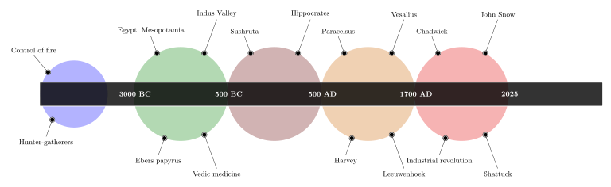{width="100%"}
:::
:::

## Learning objectives

By the end of this lecture you should be able to:

1. Describe how early humans and the first farming societies explained and treated illness
2. Name two contributions each of Egyptian, Indus Valley and Indian (Vedic/Ayurvedic) medicine
3. Explain why Hippocrates is called the "father of medicine" and what changed in his approach
4. Link one ancient practice (for example Indus drainage) to a modern public health measure

## Today on the timeline

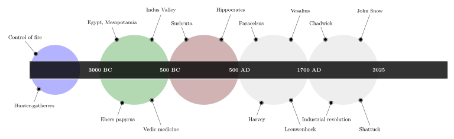{fig-align="center" width="100%"}

::: {.callout-note appearance="simple"}
Coloured phases are today: prehistory, the first river civilisations, and the classical world.
:::

## Question

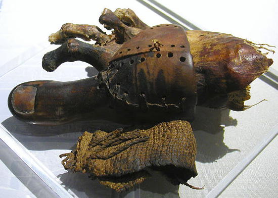{fig-align="center" height="320"}

::: {.callout-tip appearance="simple"}
This toe was made in ancient Egypt. Who made it, and why? Was it for walking or for looks?
:::

::: aside
Image: Greville Chester toe, British Museum (via seminar deck; licence to be confirmed).
:::

## Prehistory: fire changes everything

:::: {.columns}
::: {.column width="50%"}
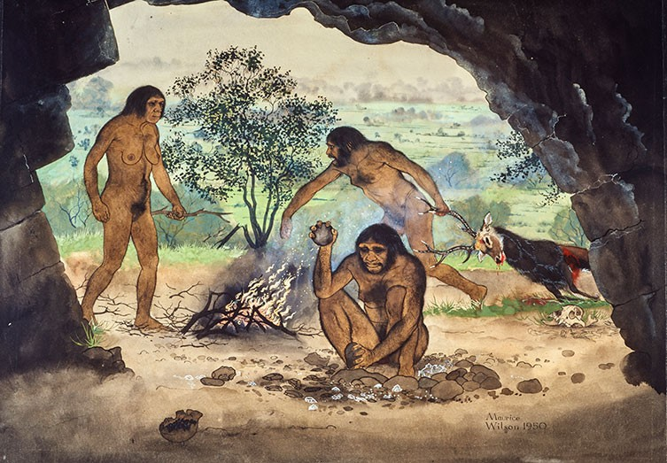{width="100%"}
:::
::: {.column width="50%"}
- Cooked food, warmth, protection, a gathering place
- Fire also kills some germs and parasites in food and water
- Evidence of care: injured and disabled people survived in some early groups
:::
::::

## Prehistory: tools

:::: {.columns}
::: {.column width="50%"}
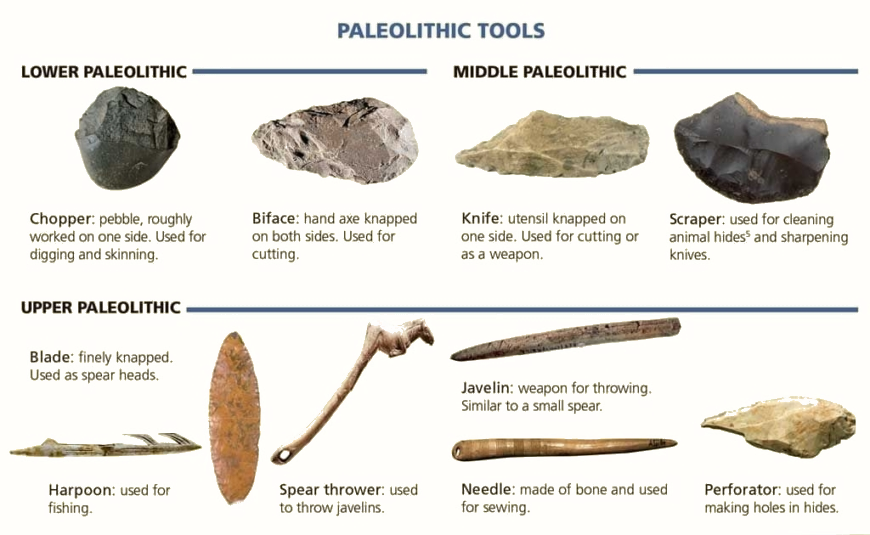{width="100%"}
:::
::: {.column width="50%"}
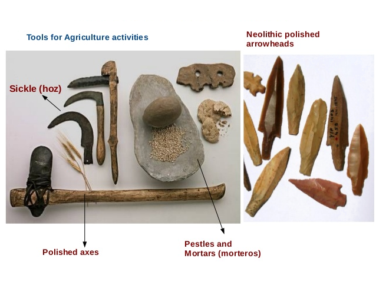{width="100%"}
:::
::::

## Early surgery: holes in the skull

:::: {.columns}
::: {.column width="50%"}
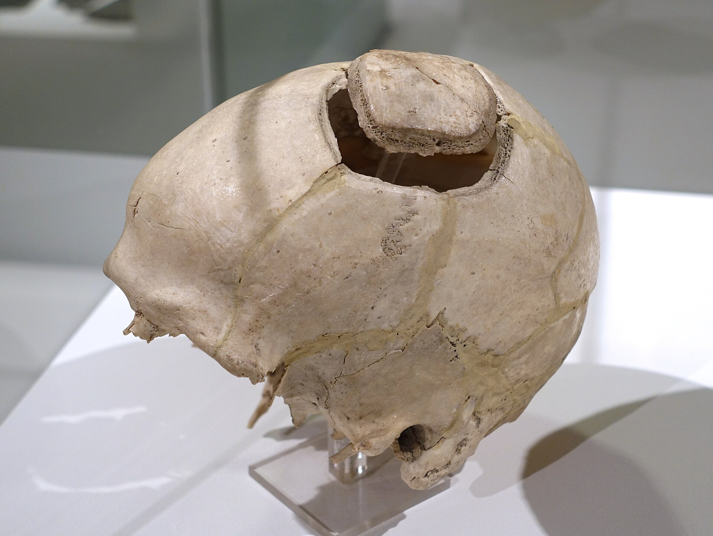{height="320"}
:::
::: {.column width="50%"}
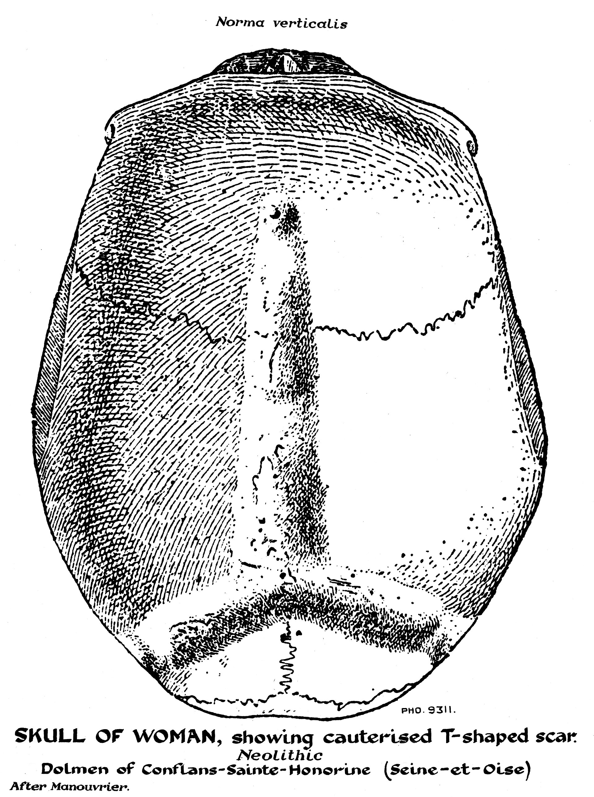{height="320"}
:::
::::

Some skulls show bone regrowth at the edges, so the person lived on after the operation.

::: aside
Sources: Daderot (public domain); Wellcome Collection (CC BY 4.0).
:::

## From hunting to farming

:::: {.columns}
::: {.column width="50%"}
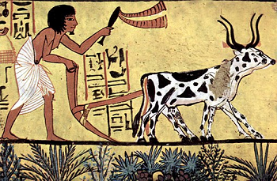{width="100%"}
:::
::: {.column width="50%"}
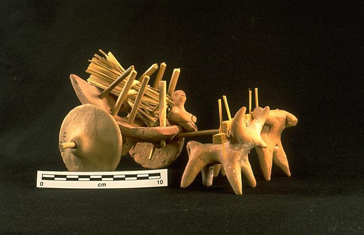{width="100%"}
:::
::::

Settled life brought crowding, animals living close to people, shared water, stored grain and waste.

## Did farming make people sicker?

- In the southern Levant, farmers' skeletons show more infection lesions than hunter-gatherers' (205 vs 200 skeletons compared)
- But a study in the German loess zone found no sign of epidemics
- Safe summary: **farming tended to raise exposure to infection, but the picture is complex**

::: {.callout-note appearance="simple"}
Public health link: the way people live decides which diseases they get.
:::

::: aside
Source: Eshed et al. 2010 (Am J Phys Anthropol); Fuchs et al. 2019 (Holocene).
:::

## Cradles of civilisation

:::: {.columns}
::: {.column width="33%"}
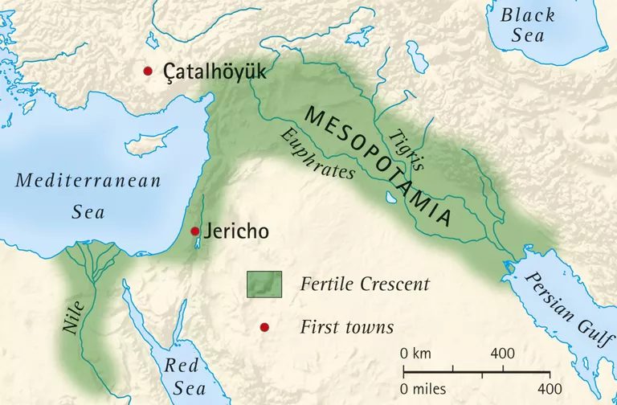{width="100%"}
:::
::: {.column width="33%"}
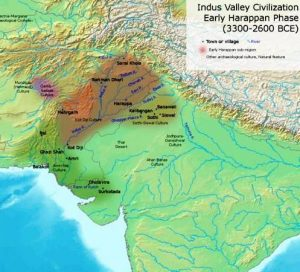{width="100%"}
:::
::: {.column width="33%"}
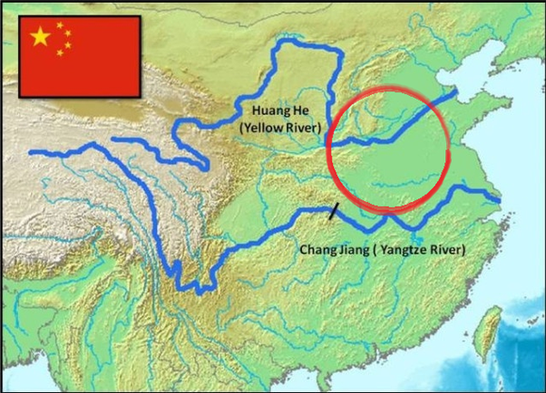{width="100%"}
:::
::::

Grain, safe-to-drink water, writing and accounting: the base for the first medical texts.

## Egypt: the papyri {.smaller}

:::: {.columns}
::: {.column width="50%"}
{height="260"}
:::
::: {.column width="50%"}
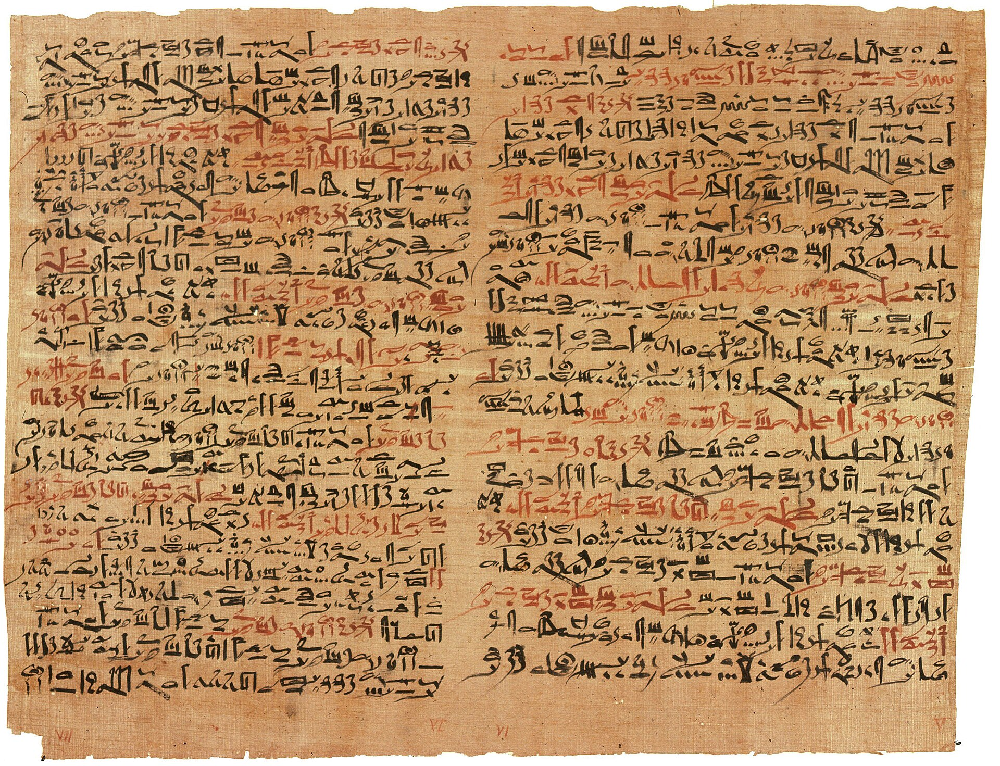{height="260"}
:::
::::

- **Ebers** (about 1550 BC): a scroll of about 110 pages, with roughly 700 remedies and spells
- **Edwin Smith** (about 1600 BC): 48 trauma cases

::: aside
Sources: Wikimedia Commons (public domain).
:::

## Ebers papyrus: drug, ritual and observation together {.smaller}

:::: {.columns}
::: {.column width="50%"}
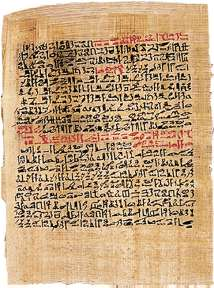{height="320"}
:::
::: {.column width="50%"}
- Remedies are written with the ingredients and how to use them
- Many remedies come with a spell
- Medicine and religion were not separate
- The scroll is also a record of what the Egyptians had observed
:::
::::

## Edwin Smith papyrus: a method

Each case follows a pattern:

1. **Title** (the injury)
2. **Examination:** "If you examine a man having..."
3. **Diagnosis** (the verdict)
4. **Treatment** (only if the case can be treated)
5. **Gloss** (explanatory note)

. . .

::: {.callout-important appearance="simple"}
**Three possible verdicts:** "an ailment I can treat", "an ailment I will contend with", "an ailment not to be treated". This is an early idea of prognosis.
:::

::: aside
Source: van Middendorp et al. 2010, Eur Spine J.
:::

## Life in Egypt

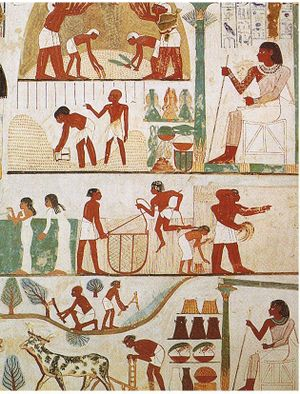{fig-align="center" height="340"}

Farming, harvest and food are the background to health: grain, beer, and the Nile.

## Mesopotamia: Hammurabi's laws {.smaller}

:::: {.columns}
::: {.column width="45%"}
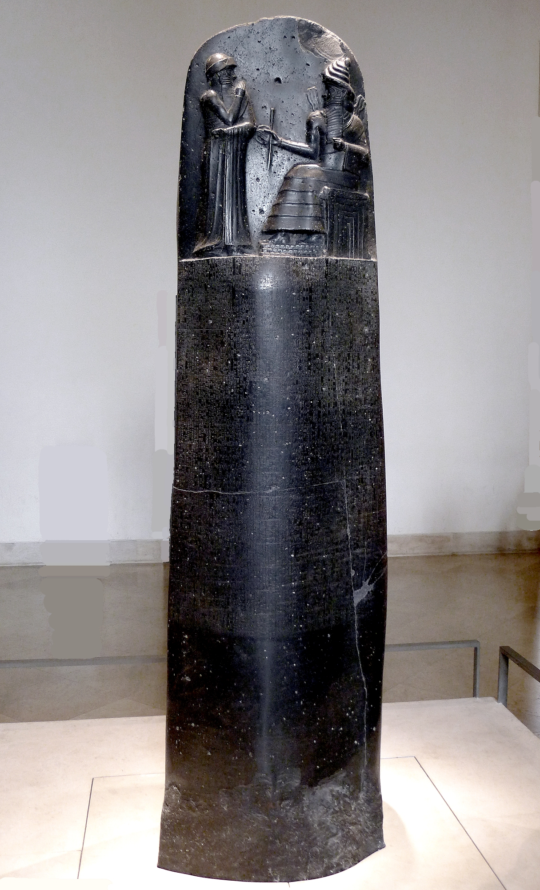{height="400"}
:::
::: {.column width="55%"}
About 1750 BC, Babylon. Laws 215 to 223 deal with the surgeon:

- Fees depended on the patient's class
- A large incision that cured: 10 shekels (free man), 5 (freed man)
- If the patient died, the surgeon's hands could be cut off
:::
::::

::: aside
Source: King LW translation (Avalon Project); photo by Mbzt, CC BY 3.0.
:::

## Hammurabi: why it matters

::: {.callout-tip appearance="simple"}
The first written rules on payment and liability for doctors. Think of informed consent and malpractice law today.
:::

Note: the laws speak only about the surgeon with the knife. Healers who used herbs and incantations are not in them.

## Indus Valley: a city of water

:::: {.columns}
::: {.column width="50%"}
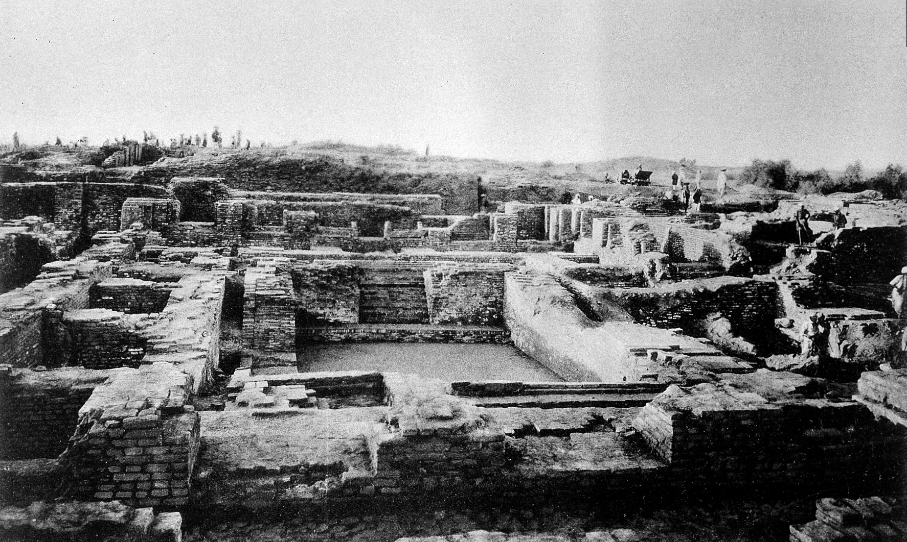{height="320"}
:::
::: {.column width="50%"}
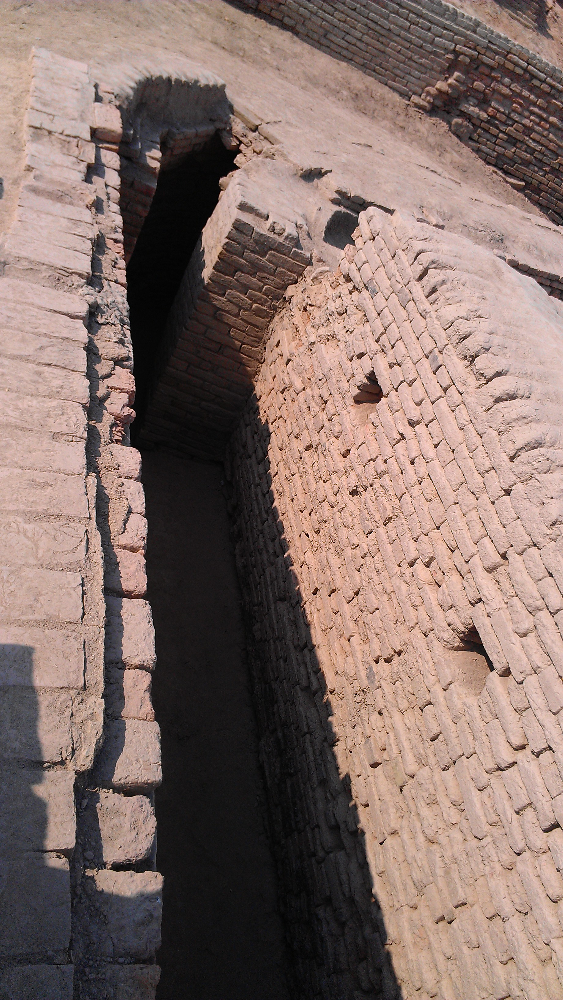{height="320"}
:::
::::

Mature Harappan period: about 2600 to 1900 BC.

::: aside
Sources: Wellcome Collection (CC BY 4.0); Quratulain (CC BY-SA 3.0).
:::

## Indus Valley: sanitation before germ theory {.smaller}

:::: {.columns}
::: {.column width="55%"}
- Brick-lined drains from houses to covered street drains with inspection holes
- Private bathrooms, terracotta pipes, soak pits
- More than 700 wells at Mohenjo-daro
:::
::: {.column width="45%"}
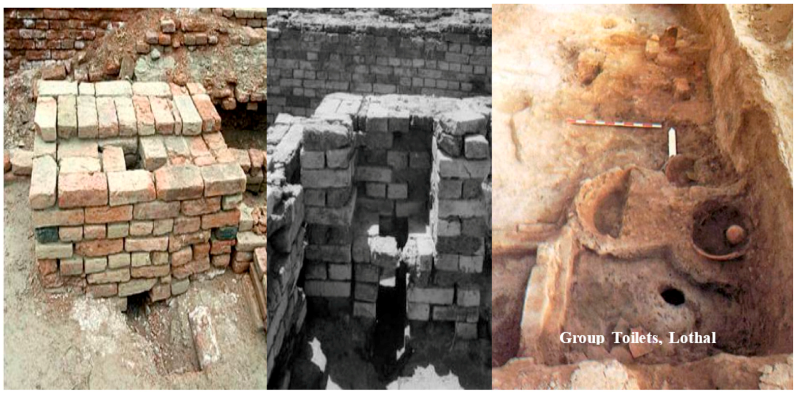{width="100%"}
:::
::::

::: {.callout-warning appearance="simple"}
We know the engineering. We do **not** know that it reduced disease. The purpose of the Great Bath is also uncertain.
:::

::: aside
Source: Jansen 1989, World Archaeol.
:::

## Indus Valley: society

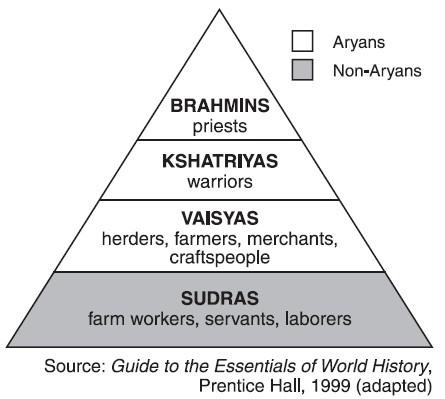{fig-align="center" height="440"}

## Question

Which modern public health programme does Indus sanitation remind you of?

. . .

::: {.callout-tip appearance="simple"}
Safe water and sanitation: Swachh Bharat, Jal Jeevan Mission, and WASH in general.
:::

## Vedic ideas of health

:::: {.columns}
::: {.column width="50%"}
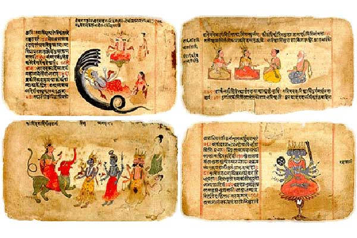{height="320"}
:::
::: {.column width="50%"}
- Health and disease are explained in the Vedas, with prayers, herbs and water
- Ayurveda grew from this tradition
- Health is **balance**: the three doshas (vata, pitta, kapha)
- Two great texts: **Charaka** (medicine) and **Sushruta** (surgery)
:::
::::

## Sushruta: the surgeon {.smaller}

:::: {.columns}
::: {.column width="40%"}
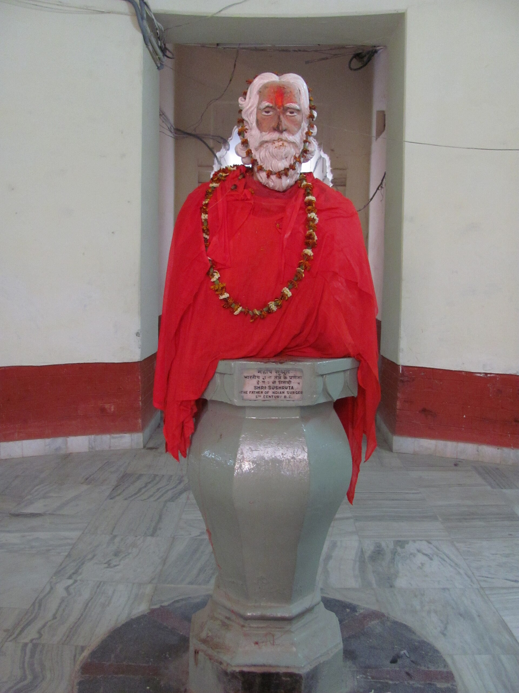{height="360"}
:::
::: {.column width="60%"}
- Date is disputed. Traditionally "about 600 BC"; the text grew over several centuries. Oldest dated manuscript: AD 878
- Traditionally quoted: 184 chapters, 1,120 conditions, about 300 procedures, over 120 instruments
- Covers surgery, anatomy by dissection, fractures, wounds and surgical training
:::
::::

::: aside
Photo: Dr.jayan.d, CC BY-SA 3.0. Counts are traditional figures, not a count of the Sanskrit text.
:::

## Sushruta Samhita

:::: {.columns}
::: {.column width="33%"}
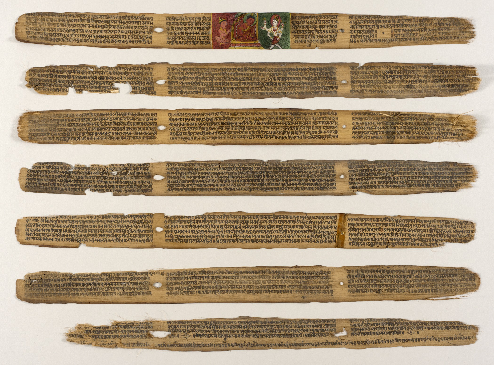{width="100%"}
:::
::: {.column width="33%"}
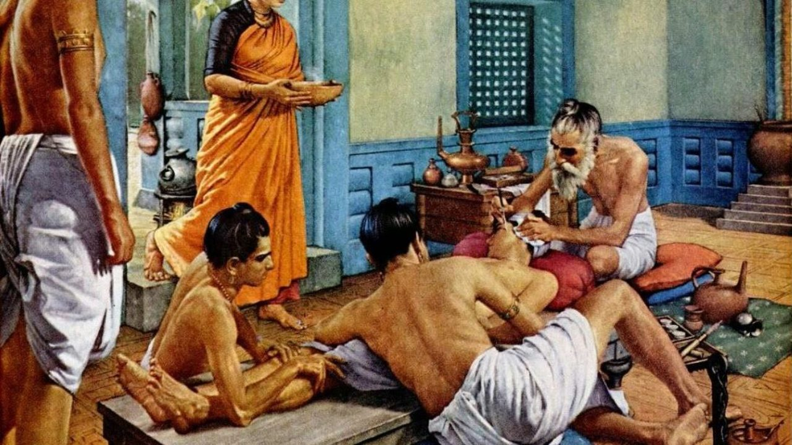{width="100%"}
:::
::: {.column width="33%"}
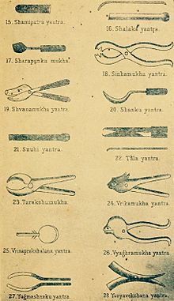{width="100%"}
:::
::::

## Sushruta and the nose

- Cutting off the nose was a punishment, so reconstruction was needed
- The text describes a **cheek-flap** repair, using a leaf as a template for the missing tissue
- The famous forehead flap is **not** in Sushruta. It is documented later, and reached Europe through a 1794 report

::: {.callout-note appearance="simple"}
Plastic surgery has a long Indian history, but be exact about what the text says.
:::

::: aside
Sources: Wallace 1978, J R Soc Med; Shaye 2021.
:::

## Sushruta: a charge to the pupil

> "Thou shalt renounce lust, anger, greed, ignorance, vanity... live the life of a truthful, self-controlled anchorite and be obedient and respectful towards thy preceptor."

- Given at the **start** of training. The Hippocratic Oath comes at the end
- Teachers, friends, the poor and helpless are to be treated without payment
- The same passage excludes some people from treatment. A good case for an ethics discussion

::: aside
Source: Bhishagratna 1907, Sutrasthana, ch. II.
:::

## Arthashastra: the state and epidemics {.smaller}

:::: {.columns}
::: {.column width="50%"}
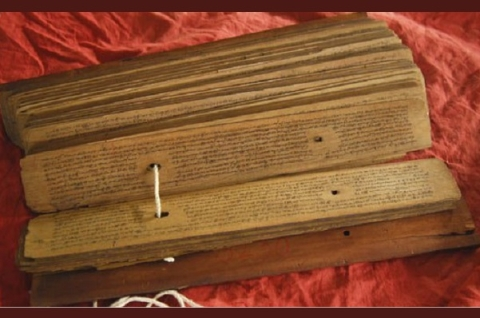{height="320"}
:::
::: {.column width="50%"}
- Attributed to Kautilya, a Mauryan minister, about 300 BC. The text was assembled between roughly 150 BC and AD 300
- Book 4, ch. 3: against pestilence, use physicians with medicines, and ascetics with purificatory rites
- Medicine and ritual side by side, led by the state
:::
::::

::: aside
Source: Shamasastry translation; Olivelle 2013.
:::

## Mauryan empire

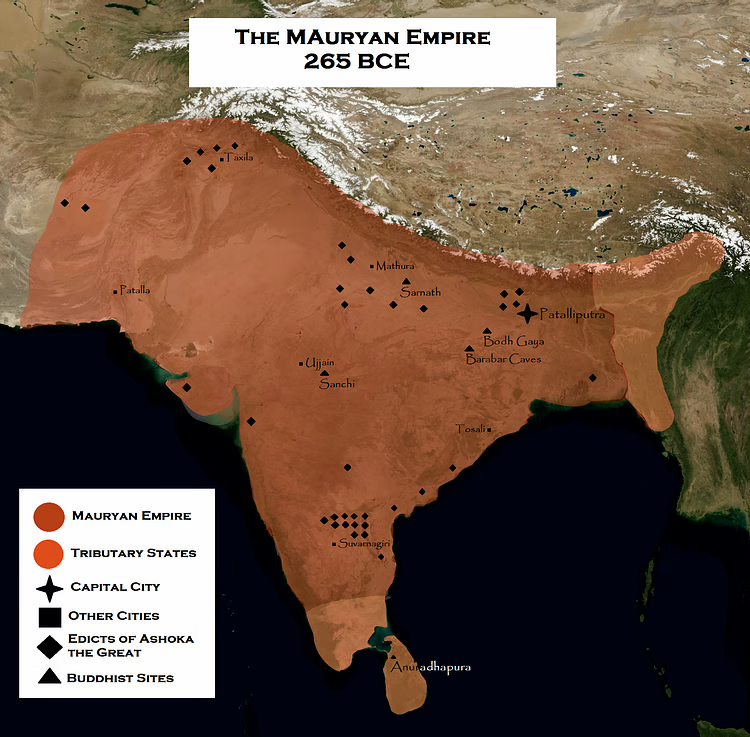{fig-align="center" height="440"}

## Greece: from spirits to nature

:::: {.columns}
::: {.column width="40%"}
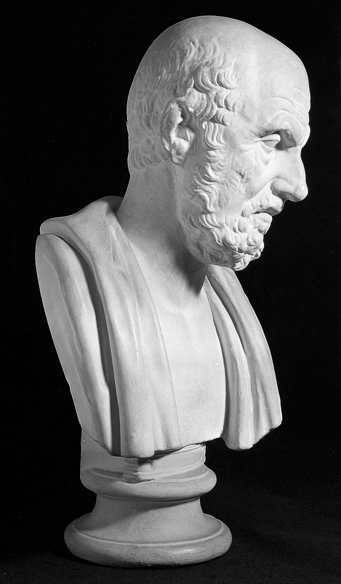{height="380"}
:::
::: {.column width="60%"}
- Hippocrates, born about 460 BC on Kos. The Corpus has many authors over centuries
- *On the Sacred Disease*: epilepsy is "nowise more divine nor more sacred than other diseases"
- Disease has natural causes, so it can be studied
:::
::::

::: aside
Image: Wellcome Collection, CC BY 4.0. The portrait type is a later conception.
:::

## Airs, Waters, Places

:::: {.columns}
::: {.column width="50%"}
The physician should begin with the **seasons, winds and waters** of a place.

People who drink marsh water have "large and obstructed spleens".
:::
::: {.column width="50%"}
::: {.callout-note appearance="simple"}
Public health link: the **environment** as a cause of disease. This is early environmental epidemiology, and a clue to malaria.
:::
:::
::::

::: aside
Source: Adams translation, MIT Internet Classics Archive.
:::

## The humours

:::: {.columns}
::: {.column width="50%"}
{height="320"}
:::
::: {.column width="50%"}
- Blood, phlegm, yellow bile, black bile
- Health is balance, as in the Indian doshas
- The scheme in *Nature of Man* is usually credited to Polybus, not to Hippocrates himself
- Treatment: diet, rest, bleeding
:::
::::

## The Hippocratic Oath {.smaller}

:::: {.columns}
::: {.column width="45%"}
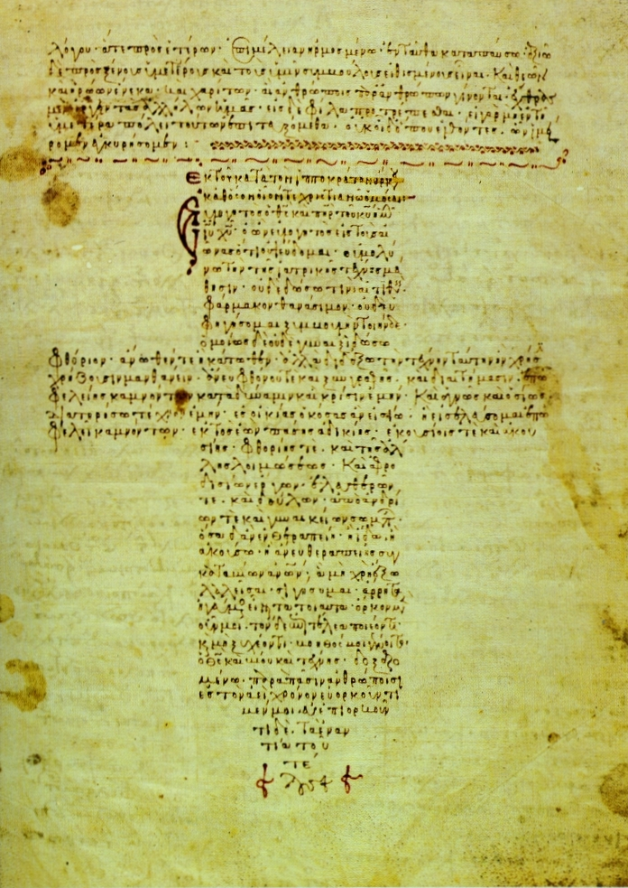{height="320"}
:::
::: {.column width="55%"}
- "I will use those dietary regimens which will benefit my patients"
- "I will do no harm or injustice to them"
- "I will keep secret... all such things"
- "I will not use the knife, even upon those suffering from stones"
:::
::::

::: aside
Translation: North 2002, NLM. Image: Vatican Library, public domain.
:::

## Beyond Greece: China {.smaller}

:::: {.columns}
::: {.column width="55%"}
- *Huangdi Neijing* (Yellow Emperor's Inner Classic), compiled in the Han period, about 2nd to 1st century BC. The Yellow Emperor attribution is traditional
- Health is **balance**: yin and yang, five phases, and *qi* flowing in channels. The same idea as humours and doshas
- It values **prevention**: the best physician acts before disease has formed
- Smallpox inoculation (variolation) is recorded in China from about the 16th century
:::
::: {.column width="45%"}
::: {.callout-note appearance="simple"}
Public health link: **prevention before illness**. Two thousand years before screening and vaccination programmes.
:::
:::
::::

::: aside
Sources: Unschuld 2003, *Huang Di Nei Jing*; Needham, *Science and Civilisation in China*.
:::

## Alexandria: dissection of the human body {.smaller}

- Under the Ptolemies, **Herophilus** (about 335 to 280 BC) and **Erasistratus** (about 304 to 250 BC) dissected human bodies. This was rare in the ancient world
- Herophilus placed intelligence in the **brain**, separated nerves from tendons, and timed the pulse
- Later writers (Celsus) say condemned prisoners were cut open alive. Historians dispute this
- The knowledge was largely lost. Galen, centuries later, worked from animals. Lecture 2 shows what that cost

::: aside
Sources: von Staden 1989, *Herophilus*; Nutton 2013, *Ancient Medicine*.
:::

## Rome: public health as engineering {.smaller}

:::: {.columns}
::: {.column width="55%"}
- **Cloaca Maxima**, the great sewer of Rome (traditionally 6th century BC)
- **Aqua Appia**, the first aqueduct, 312 BC. By about AD 97 Frontinus, the water commissioner, lists nine
- Vitruvius advised building towns away from marshes
- Army hospitals (*valetudinaria*) cared for soldiers
:::
::: {.column width="45%"}
::: {.callout-note appearance="simple"}
Public health link: **clean water, drains and site planning** are state works. Rome did them without any germ theory. Compare the Indus Valley.
:::
:::
::::

::: aside
Sources: Frontinus, *De aquaeductu*; Vitruvius, *De architectura*, Book 1; Scobie 1986, Klio 68.
:::

## Recap

{fig-align="center" width="100%"}

- Fire, farming and early surgery: illness explained by belief, and treated by trial and care
- Egypt and Mesopotamia: written cases, written rules for doctors
- Indus Valley and India: sanitation, balance and surgery
- Greece: natural causes and the environment
- China, Alexandria and Rome: prevention, human dissection, and public works

## Quiz: question 1 of 8

Which ancient civilisation is known for covered drains and private bathrooms in towns?

a) Egyptian

b) Indus Valley

c) Sumerian

d) Greek

## Quiz: question 2 of 8

The Edwin Smith papyrus is best described as:

a) a spell book

b) a list of kings

c) a set of trauma cases with exam, diagnosis and a verdict

d) a map of the Nile

## Quiz: question 3 of 8

Sushruta is chiefly associated with:

a) physiology

b) surgery

c) epidemiology

d) pharmacology

## Quiz: question 4 of 8

Airs, Waters, Places argued that:

a) gods send disease

b) the environment influences disease

c) blood circulates

d) germs cause fever

## Quiz: question 5 of 8

Moving from hunting to farming most likely:

a) removed infections

b) tended to raise exposure to infection

c) had no effect

d) ended injuries

## Quiz: question 6 of 8

A text attributed to the Mauryan minister Kautilya, which describes state duties including epidemic response, is:

a) Rig Veda

b) Charaka Samhita

c) Arthashastra

d) Manusmriti

## Quiz: question 7 of 8

Which ancient civilisation is best known for aqueducts and a great sewer, built without any germ theory?

a) Rome

b) Egypt

c) Sumer

d) Han China

## Quiz: question 8 of 8

The *Huangdi Neijing* is notable for:

a) the first surgery text

b) a list of kings

c) the first microscope study

d) health as balance, with stress on prevention

## Quiz answers

1. **b** Indus Valley
2. **c** trauma cases with exam, diagnosis and a verdict
3. **b** surgery
4. **b** the environment influences disease
5. **b** tended to raise exposure to infection
6. **c** Arthashastra
7. **a** Rome
8. **d** health as balance, with stress on prevention

## Take-home

- Every culture explained illness. The shift that matters: **from spirits and fate to natural causes, and from the individual to the environment**
- Ancient sources are uncertain. Ask: who wrote this, when, and for whom?
- Next lecture: how observation, dissection, the microscope and counting replaced authority

## References {.smaller}

- van Middendorp JJ, et al. The Edwin Smith papyrus. Eur Spine J. 2010;19(11):1815-23. doi:10.1007/s00586-010-1523-6
- King LW, transl. The Code of Hammurabi. Avalon Project. avalon.law.yale.edu/ancient/hamcode.asp
- Jansen M. Water supply and sewage disposal at Mohenjo-daro. World Archaeol. 1989;21(2):177-92
- Wallace AFC. History of plastic surgery. J R Soc Med. 1978
- Bhishagratna KKL, transl. Sushruta Samhita. 1907
- Olivelle P, transl. King, governance, and law in ancient India: Kautilya's Arthasastra. OUP; 2013
- Adams F, transl. On airs, waters, and places. classics.mit.edu/Hippocrates/airwatpl.html
- North M, transl. Hippocratic Oath. NLM; 2002
- Unschuld PU, Tessenow H. Huang Di Nei Jing Suwen. Univ California Press; 2011
- von Staden H. Herophilus: the art of medicine in early Alexandria. CUP; 1989
- Frontinus. De aquaeductu urbis Romae (about AD 97); Vitruvius. De architectura
- Eshed V, et al. Paleopathology and the origin of agriculture in the Levant. Am J Phys Anthropol. 2010;143(1):121-33

