## Where we left off {.smaller}

::: {.columns}
::: {.column width="55%"}
**Lecture 1** ended with Greece: disease has natural causes, and the environment matters.

For about 1,500 years after that, one book-based tradition (Galen, the humours) set the rules.

**Today:** how dissection, experiment, the microscope and counting broke its hold.

**Next:** how those methods were turned on whole populations (public health).
:::
::: {.column width="45%"}
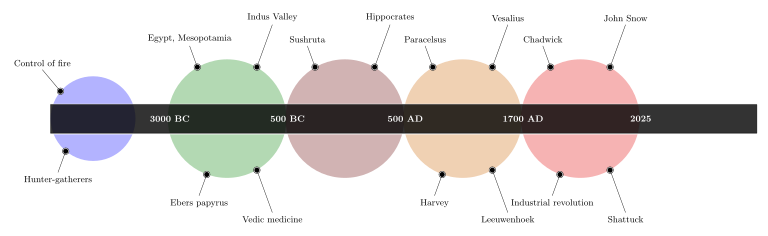{width="100%"}
:::
:::

## Learning objectives

By the end of this lecture you should be able to:

1. Explain why Galen's ideas lasted over 1,000 years, and what ended his authority
2. Describe the contribution of Vesalius, Harvey, Paracelsus, Paré and Leeuwenhoek in one sentence each
3. Explain why John Graunt's analysis of the Bills of Mortality is an early form of epidemiology
4. State how observation, dissection, experiment and counting replaced authority as sources of medical knowledge

## Today on the timeline

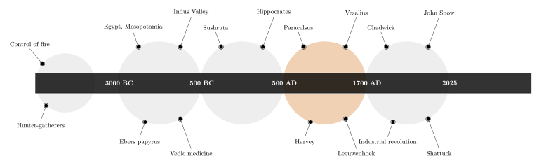{fig-align="center" width="100%"}

::: {.callout-note appearance="simple"}
The coloured phase is today: about AD 500 to 1700.
:::

## Question

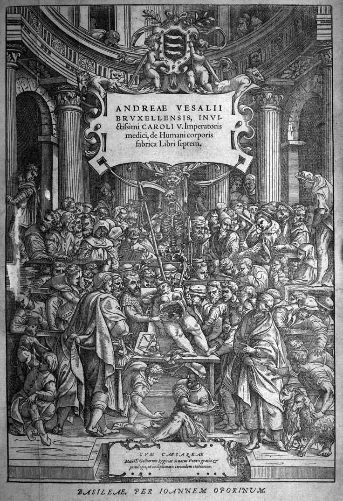{fig-align="center" height="300"}

::: {.callout-tip appearance="simple"}
This is the 1543 title page of the *Fabrica*. Vesalius is at the dissection table himself. Why did it take until 1543 to correct Galen?
:::

::: aside
Image: McLeod, Wikimedia Commons (public domain).
:::

## Galen: the authority {.smaller}

:::: {.columns}
::: {.column width="55%"}
- Born in Pergamon in AD 129. Death given as about AD 200 or 216
- Physician to gladiators and to emperors
- Wrote on anatomy, physiology and treatment, and wrote with great confidence
- His anatomy relied largely on **animal** dissection
- For centuries, a Galenic text was the final answer
:::
::: {.column width="45%"}
::: {.callout-note appearance="simple"}
Medieval teaching meant reading Galen aloud while someone else dissected. The text was the test, not the body.
:::
:::
::::

::: aside
Sources: Encyclopedia.com; Nutton 1973. Death date varies by source.
:::

## Islamic medicine: Al-Razi (Rhazes) {.smaller}

- Lived about 865 to 925 in Rayy and Baghdad
- Separated **smallpox** from **measles** by symptoms:

> "the pain in the back is more peculiar to the smallpox than to the measles... the inquietude, nausea and anxiety are more frequent in the measles than in the smallpox"

- His *al-Hawi* was a commonplace book of clinical cases. He told students to keep their own records
- About 40 Latin editions of his smallpox treatise between 1498 and 1866

::: {.callout-note appearance="simple"}
Differential diagnosis from bedside observation, 1,000 years before germ theory.
:::

::: aside
Source: Hajar 2013, Heart Views (quotes are an English rendering).
:::

## Ibn Sina and the *Canon* {.smaller}

:::: {.columns}
::: {.column width="40%"}
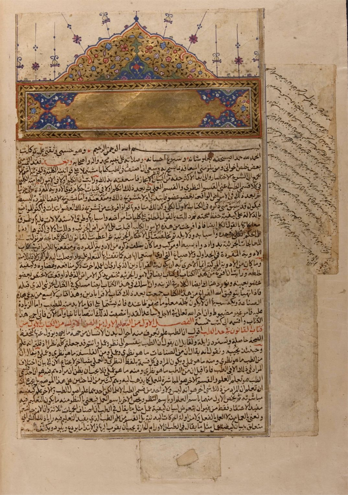{height="380"}
:::
::: {.column width="60%"}
- Ibn Sina (Avicenna, 980 to 1037). The *Canon of Medicine* was completed around 1025
- Translated into Latin in the 12th century
- In the last 30 years of the 1400s, about 15 Latin editions were printed
- Used in university teaching into the 1600s
:::
::::

::: {.callout-warning appearance="simple"}
Authority from a book. This is what the Scientific Revolution attacks.
:::

::: aside
Image: public domain. Sources: Kelsey Museum, Univ. of Michigan; Source Library.
:::

## The bimaristan: a hospital as an institution {.smaller}

- The Al-'Adudi hospital in Baghdad opened in AD 981
- Paid for by the ruler's own endowment (*waqf*), not by the patient
- Destroyed in the Mongol sack of Baghdad in 1258

::: {.callout-tip appearance="simple"}
An institution, not just an individual healer. Compare with a modern district hospital.
:::

::: aside
Source: secondary (Wikipedia, citing Hamarneh 1962). A story that Al-Razi chose the site cannot be true: he died about 56 years earlier.
:::

## The Black Death and the first quarantine {.smaller}

- Reached Messina in October 1347. Main wave 1347 to 1351
- Mortality: "up to a third or more", **varying by region**. "Half of Europe" is popular but contested
- **Venice, 1348:** a council could hold ships and people for 40 days
- **Ragusa (Dubrovnik), 1377:** 30 days for ships (*trentina*), 40 days for land travellers (*quarantena*, from *quaranta*, forty)

. . .

::: {.callout-important appearance="simple"}
People acted on a **population** without knowing the cause. The plague bacterium was found only in the 1890s.
:::

::: aside
Sources: Conti 2008; Gensini, Yacoub, Conti 2004, J Infect; Izdebski et al. 2022.
:::

## Da Vinci: drawing what he saw

:::: {.columns}
::: {.column width="45%"}
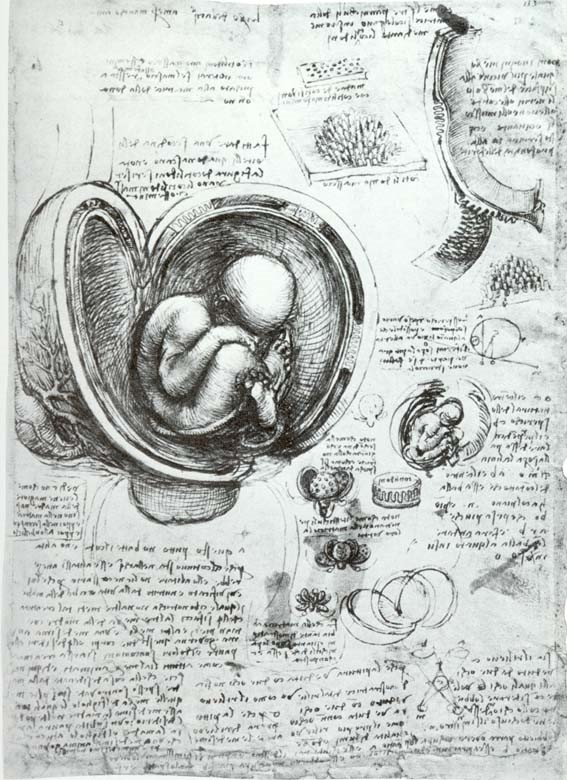{height="380"}
:::
::: {.column width="55%"}
- Dissected human bodies and drew the results in notebooks
- Drawings of the womb, heart and muscles
- Shows the habit that matters: **look, then record**
:::
::::

::: aside
Image: from seminar deck (public domain work; scan source to be confirmed).
:::

## Vesalius and the *Fabrica* (1543) {.smaller}

:::: {.columns}
::: {.column width="40%"}
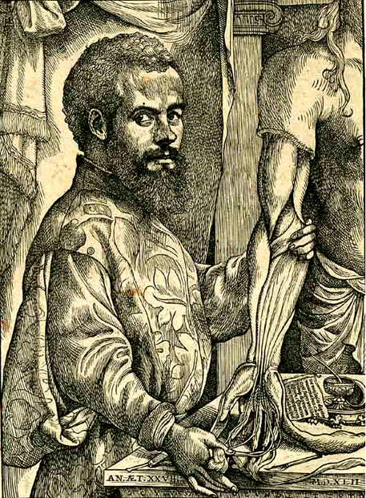{height="340"}
:::
::: {.column width="60%"}
- *De humani corporis fabrica*, Basel, June 1543. Vesalius was 28
- He corrected about 300 of Galen's errors using **human** dissection
- Examples: the mandible is one bone, not two; men and women have the same number of ribs; the great vessels do not start in the liver
- He still kept Galen's idea that veins and arteries carry different kinds of blood
:::
::::

::: {.callout-note appearance="simple"}
Even the corrector inherited errors. The **method**, not the man, was the revolution.
:::

::: aside
Source: O'Malley 1964, via Wikipedia (secondary). Portrait: seminar deck.
:::

## The *Fabrica* plates

:::: {.columns}
::: {.column width="50%"}
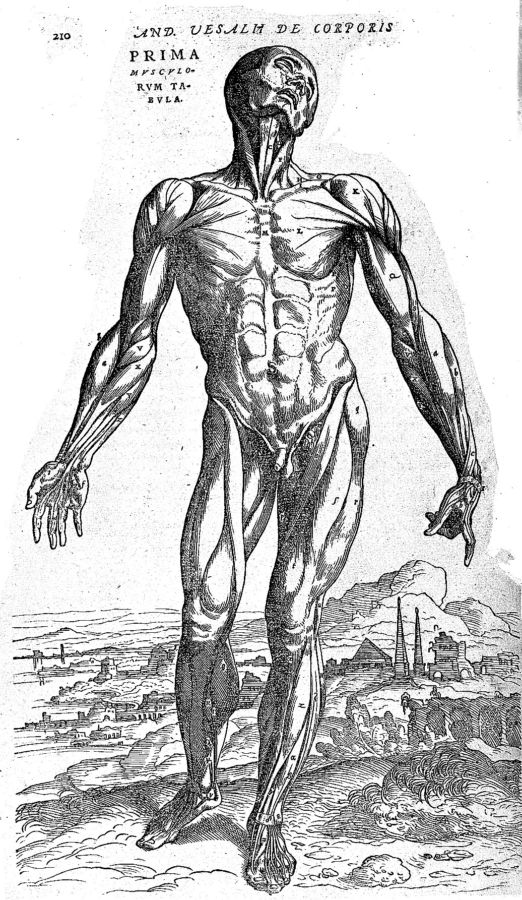{height="300"}
:::
::: {.column width="50%"}
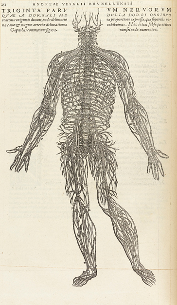{height="300"}
:::
::::

Printing let the same accurate picture reach every school.

::: aside
Image: Wellcome Collection (CC BY 4.0); seminar deck. The "Church persecuted Vesalius over a missing rib" story is not well supported.
:::

## Ambroise Paré: a lesson from running out of oil {.smaller}

:::: {.columns}
::: {.column width="50%"}
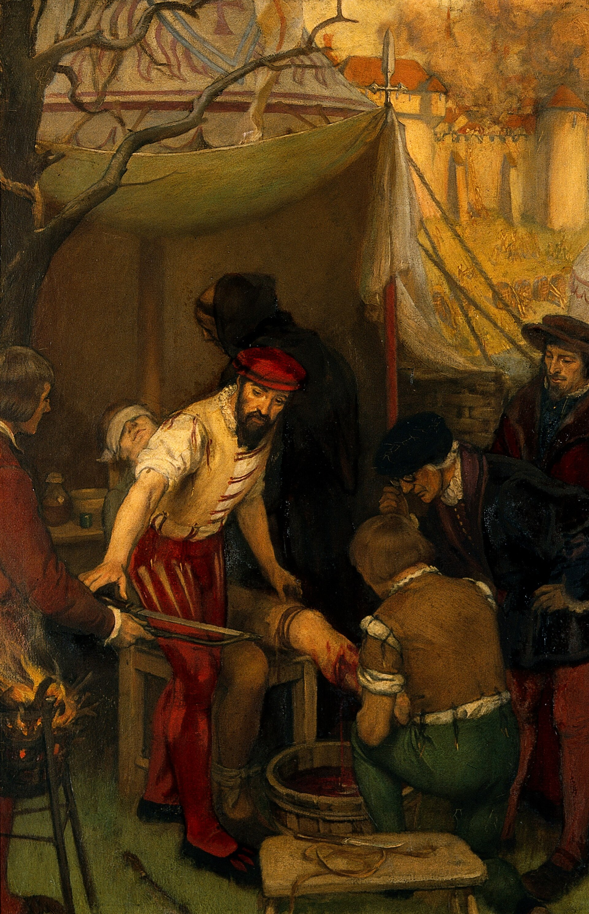{height="380"}
:::
::: {.column width="50%"}
- 1537, Italian campaign: boiling oil for gunshot wounds ran out. He used a salve of egg white, rose oil and turpentine
- The men on salve did better. He resolved "never again cruelly to burn" such patients
- Ligature after amputation: recorded from 1552. It is **older than Paré**; he popularised it
- His motto: "I dressed him, God healed him"
:::
::::

::: aside
Sources: Eamon 2010; Bhadriraju 2024, Cureus. Image: Wellcome Collection (CC BY 4.0).
:::

## Paré: why it matters

::: {.callout-tip appearance="simple"}
An unplanned comparison that looks like a trial: two groups, different treatment, compare outcomes. A bridge to counting (Graunt) and later to clinical trials.
:::

::: {.callout-warning appearance="simple"}
Be careful with the legend. Historians note he told the story himself, and that others used similar salves.
:::

## Paracelsus: the dose makes the poison {.smaller}

:::: {.columns}
::: {.column width="35%"}
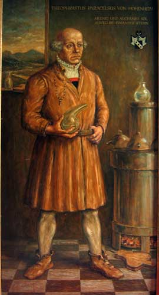{height="380"}
:::
::: {.column width="65%"}
- Died 1541. Used chemicals and minerals as remedies, against humoral treatment
- From his *Seven Defences* (written 1538, printed 1564):

> "What is there that is not poison? All things are poison and nothing is without poison. Only the dose determines that a thing is not a poison."

- Link to modern pharmacology and toxicology
:::
::::

::: aside
Sources: Aronson 2019, BMJ blogs. Paracelsus's Latin slogan is a later summary. Portrait: seminar deck.
:::

## Fracastoro: seeds of contagion {.smaller}

- **Girolamo Fracastoro** (1478 to 1553), physician and poet in Verona
- His poem *Syphilis sive morbus Gallicus* (1530) gave syphilis its name
- *De contagione* (1546): disease spreads by invisible "seeds" (*seminaria*)
- Three routes: **direct contact**, **objects** (fomites), and **at a distance**
- An early contagion theory, about **300 years** before germ theory. Miasma still won the argument until the 1800s

::: aside
Sources: Nutton 1990, Med Hist Suppl 'Fracastoro and contagion'; Wright, transl. 1930, *De contagione*.
:::

## Harvey: proving circulation {.smaller}

:::: {.columns}
::: {.column width="50%"}
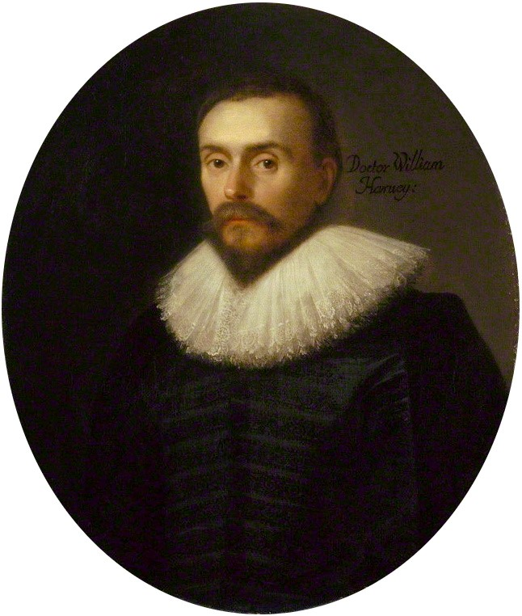{height="320"}
:::
::: {.column width="50%"}
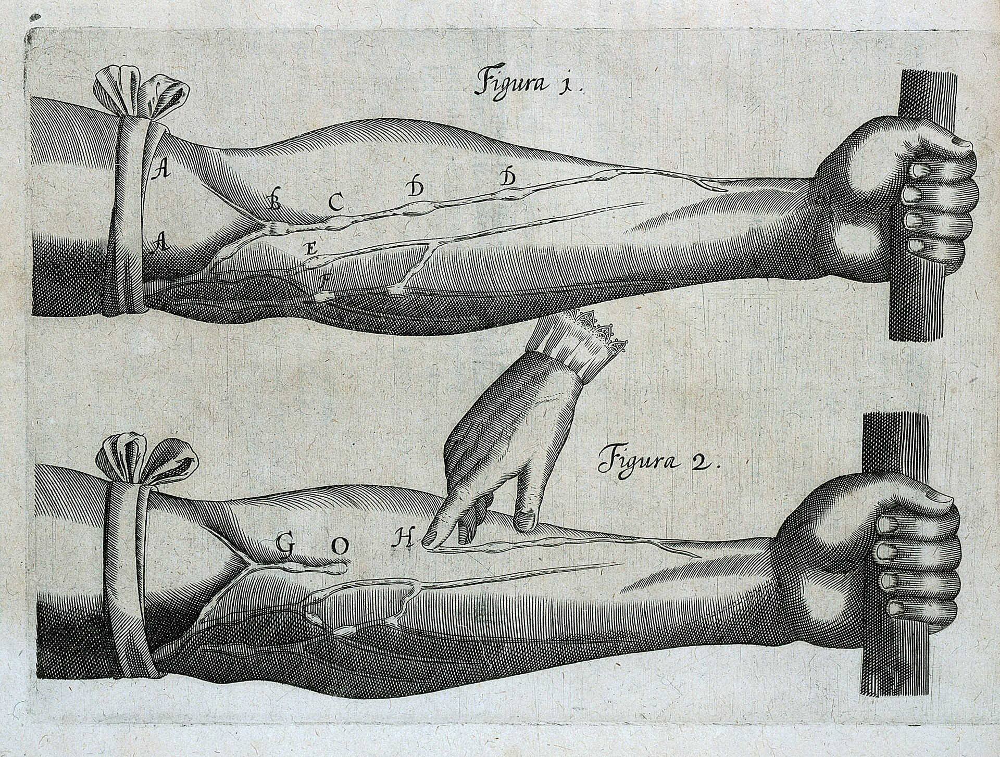{height="320"}
:::
::::

*De Motu Cordis*, Frankfurt, 1628. Tie the arm: the veins swell below the band, and the valves only let blood go one way.

::: aside
Figure: Wellcome Collection (CC BY 4.0). Portrait: seminar deck, licence to be confirmed.
:::

## Harvey: the arithmetic argument {.smaller}

> "In the course of half an hour, the heart will have made more than one thousand beats."

- He assumed each beat sends out half an ounce, three drachms, or even one drachm
- Even the smallest guess gives **more blood per hour than the whole body holds**
- So the blood must go round "a kind of circular motion"

::: {.callout-important appearance="simple"}
Reasoning from measurement, not from authority. He could not see capillaries. Malpighi saw them after Harvey's death.
:::

::: aside
Source: Willis translation (1847), ch. IX. Popular summaries ("540 lb an hour") are not from the text.
:::

## Leeuwenhoek: a draper with the best lenses {.smaller}

:::: {.columns}
::: {.column width="40%"}
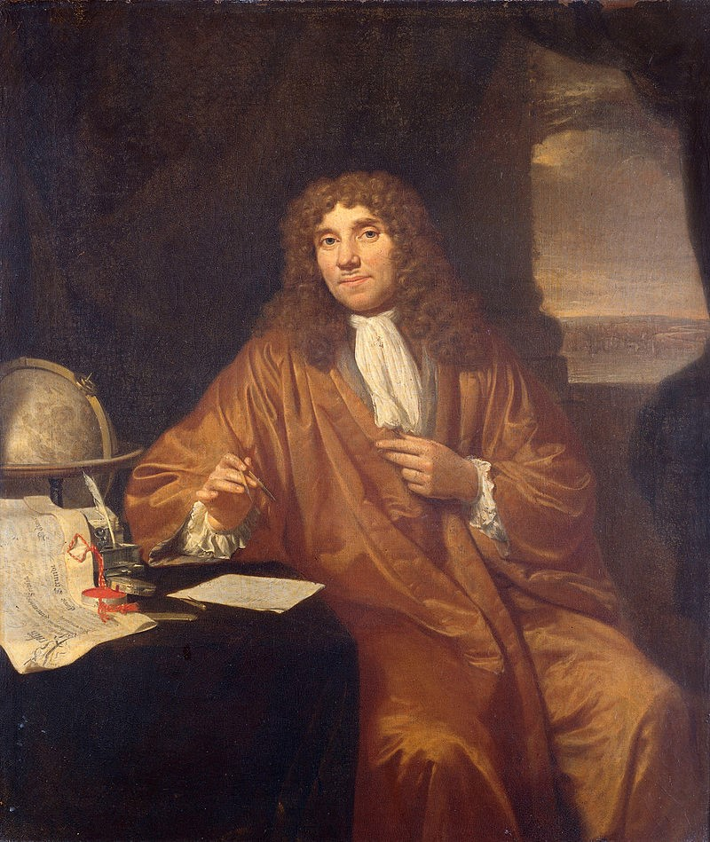{height="380"}
:::
::: {.column width="60%"}
- Cloth merchant in Delft, no university training
- Made his own single-lens microscopes. Surviving lenses reach about 270 times magnification
- Letter to Henry Oldenburg, Royal Society, **9 October 1676**: five kinds of "animalcules" in pepper water, rain, well, sea and river water
- Excerpt printed in *Philosophical Transactions*, 1677
:::
::::

::: aside
Sources: Royal Society EL/L1/22; van Zuylen 1981. Portrait: seminar deck.
:::

## What he drew

:::: {.columns}
::: {.column width="50%"}
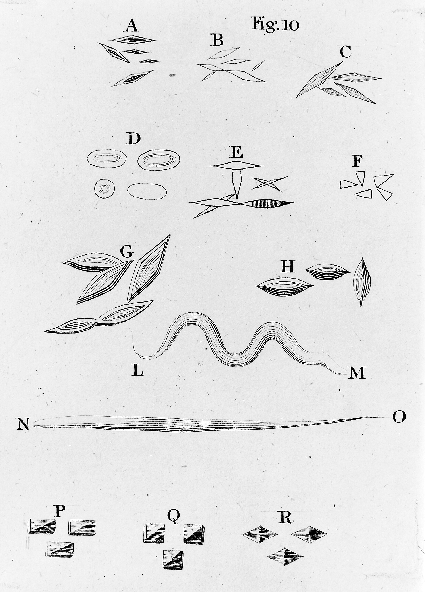{height="380"}
:::
::: {.column width="50%"}
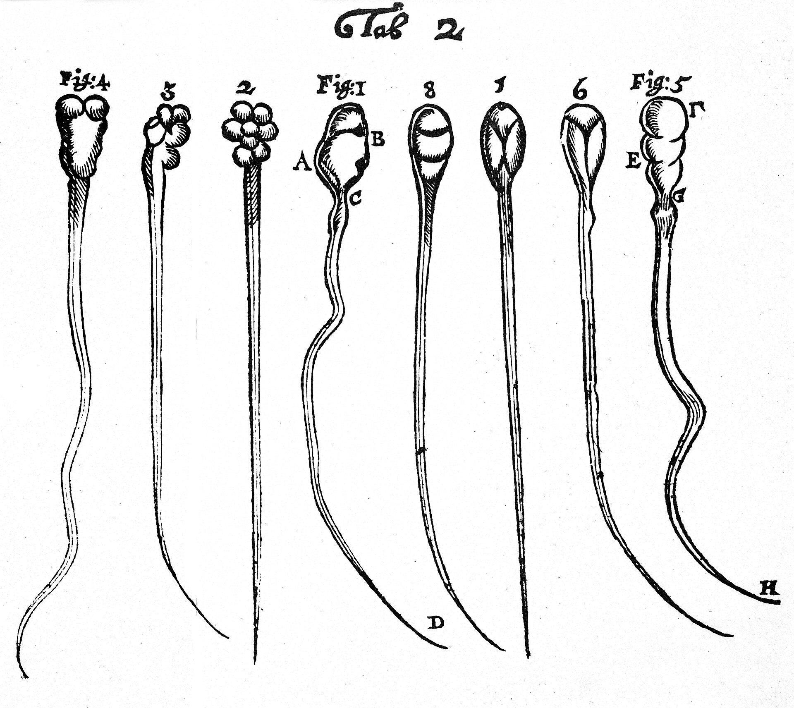{height="380"}
:::
::::

::: aside
Images: Wellcome Collection (CC BY 4.0).
:::

## A claim has to be repeated {.smaller}

:::: {.columns}
::: {.column width="45%"}
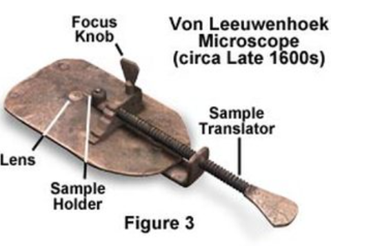{width="100%"}
:::
::: {.column width="55%"}
- The Royal Society could not at first reproduce his pepper-water animalcules
- One source says Robert Hooke finally showed members "little animals" in November 1678
- Teaching point: **replication** was already the test of a claim
:::
::::

::: {.callout-note appearance="simple"}
Public health link: you cannot fight what you cannot see. Germ theory (Lecture 3) rests on this.
:::

::: aside
Source: McCrone Research Institute (secondary). Diagram: seminar deck.
:::

## Graunt and the Bills of Mortality {.smaller}

:::: {.columns}
::: {.column width="40%"}
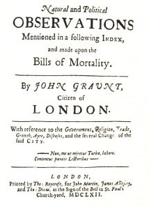{height="380"}
:::
::: {.column width="60%"}
- London draper (1620 to 1674). One book: *Natural and Political Observations... upon the Bills of Mortality*, 1662
- Presented to the Royal Society on 5 February 1662; he was elected a Fellow within weeks
- Used the weekly parish death lists, the "Bills"
:::
::::

::: aside
Source: Connor 2022, J Med Biogr. No true portrait of Graunt is known. The "Captain John Graunt" sketch is a 20th-century invention.
:::

## The raw data

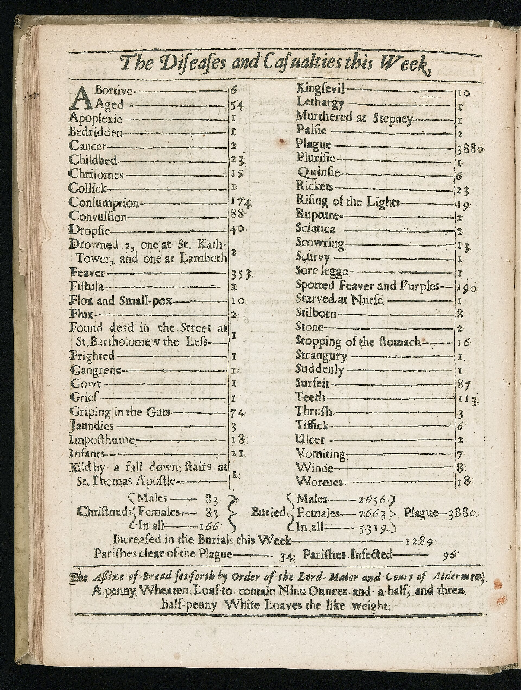{fig-align="center" height="440"}

::: aside
Image: Wellcome Collection (CC BY 4.0).
:::

## What counting showed {.smaller}

Graunt used the Bills to:

- Estimate the **size of London's population**
- Give the first careful **male-to-female ratio** at birth
- Show that **city death exceeded city births**, so London grew by immigration
- Compare London with the countryside
- Separate **epidemic** from **steady (endemic)** causes of death
- Estimate **infant mortality**

::: {.callout-note appearance="simple"}
Counting shows a pattern that no single physician can see. That is the start of epidemiology.
:::

::: aside
Source: Connor 2022. The "14 boys to 13 girls" figure is quoted only in secondary sources; do not rely on it.
:::

## What Graunt did not do

- His survival estimate was **rough, not a true life table**
- Edmond Halley's 1693 table from Breslau is usually called the first proper life table (it used age, sex and date of death)
- The book was once credited to William Petty. Current view: Graunt wrote it, Petty may have helped

::: {.callout-tip appearance="simple"}
Good science states its limits. Ask of any statistic: who counted, what, and how?
:::

## From the individual to society {.smaller}

- **Bentham**, *A Fragment on Government* (1776): the measure of right and wrong is "the greatest happiness of the greatest number"
- The phrase is older than Bentham (Hutcheson, Beccaria and Priestley are named)
- Applied to health: if suffering matters, then **sanitation and poor-law reform** become moral and political duties

::: {.callout-note appearance="simple"}
This is the idea behind Lecture 3. Do not claim Chadwick was Bentham's secretary: this is not verified.
:::

::: aside
Sources: Bentham 1776; Bentham 1789.
:::

## Recap {.smaller}

{fig-align="center" width="100%"}

- **Medieval:** Galen's authority; Al-Razi and Ibn Sina; the Black Death and quarantine
- **Renaissance:** Vesalius and Paré look again at the body
- **Experiment:** Paracelsus and Harvey test ideas with measurement
- **Microscope and counting:** Leeuwenhoek sees; Graunt counts

## Quiz: question 1 of 7

Whose anatomy did Vesalius correct in the *Fabrica*?

a) Hippocrates

b) Galen

c) Harvey

d) Paracelsus

## Quiz: question 2 of 7

William Harvey is known for:

a) the microscope

b) showing circulation of blood by experiment and measurement

c) discovering capillaries

d) vaccination

## Quiz: question 3 of 7

Paré is remembered for **popularising** which technique for amputations?

a) boiling oil

b) ligature of arteries

c) opium only

d) amputating less

## Quiz: question 4 of 7

"Only the dose determines that a thing is not a poison" is attributed to:

a) Vesalius

b) Paré

c) Paracelsus

d) Graunt

## Quiz: question 5 of 7

John Graunt is important because he:

a) built the first microscope

b) found the source of cholera

c) analysed death records to find patterns in a population

d) wrote the first anatomy atlas

## Quiz: question 6 of 7

The first quarantine measures in the 14th century show that:

a) the cause must be known before acting

b) populations can be protected without knowing the cause

c) quarantine failed

d) germ theory was accepted

## Quiz: question 7 of 7

Fracastoro's *De contagione* (1546) proposed that disease spreads by:

a) divine anger

b) imbalance of humours

c) "seeds" passed by contact, objects, or at a distance

d) bad air from marshes only

## Quiz answers

1. **b** Galen
2. **b** circulation shown by experiment and measurement (capillaries were seen later, by Malpighi)
3. **b** ligature of arteries
4. **c** Paracelsus
5. **c** analysed death records to find patterns in a population
6. **b** populations can be protected without knowing the cause
7. **c** "seeds" passed by contact, objects, or at a distance

## Take-home

- Authority gave way to **dissection, experiment, the microscope and counting**
- Beware tidy legends (Paré's oil, Paracelsus's slogan, Harvey's numbers). Go back to the text
- Next lecture: the same methods applied to **whole populations**: Chadwick, Farr and Snow

## References (1 of 2) {.smaller}

- Conti AA. Quarantine through history. In: Int Encyclopedia of Public Health. 2008:454-62. PMC7150140
- Gensini GF, Yacoub MH, Conti AA. The concept of quarantine in history: from plague to SARS. J Infect. 2004;49(4):257-61
- Hajar R. The air of history (Part IV): Al Rhazes. Heart Views. 2013;14(2):93-5
- Eamon W. The legend of Ambroise Paré and the "liberation" of surgery. 2010. williameamon.com

## References (2 of 2) {.smaller}

- Aronson J. Nothing is not a poison. BMJ blogs. 2019
- Harvey W. Anatomical disquisition on the motion of the heart and blood (Willis, transl.). 1847, ch. IX
- Connor H. John Graunt FRS (1620-74): founding father of human demography, epidemiology and vital statistics. J Med Biogr. 2022;32(1):57-69
- Murray E, et al. Is this a portrait of John Graunt? Am J Epidemiol. 2019
