## Where we left off {.smaller}

::: {.columns}
::: {.column width="55%"}
**Lecture 2** ended with new ways of knowing: dissection, experiment, the microscope, and counting (Graunt's Bills of Mortality).

**Today:** what happened when those methods were turned on **whole populations**, in the crowded industrial cities of the 1800s.

**This is where public health begins:** count, compare, then act, sometimes before the cause is known.
:::
::: {.column width="45%"}
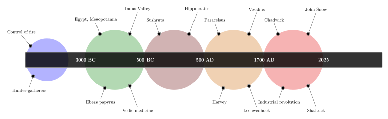{width="100%"}
:::
:::

## Learning objectives

By the end of this lecture you should be able to:

1. Explain how the industrial revolution changed patterns of disease and drove sanitary reform
2. Describe the roles of Chadwick, Farr, Snow and Shattuck in founding public health
3. Explain John Snow's Broad Street investigation as an example of the epidemiological method
4. Place germ theory and later landmarks (smallpox eradication, Bhore Committee, Alma-Ata) on the timeline

## Today on the timeline

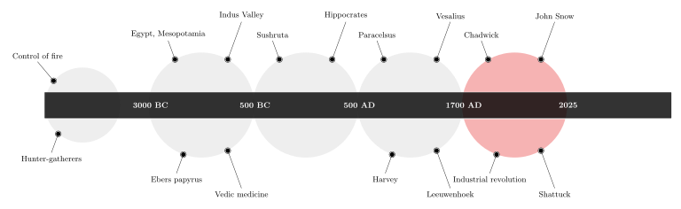{fig-align="center" width="100%"}

::: {.callout-note appearance="simple"}
The coloured phase is today: about 1700 to the present.
:::

## Question

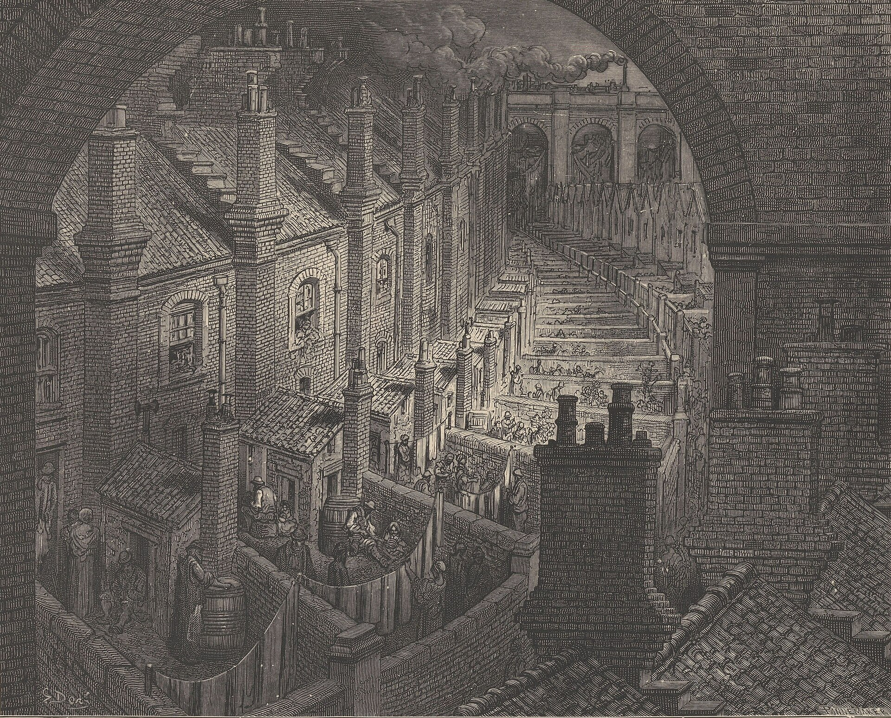{fig-align="center" height="330"}

::: {.callout-tip appearance="simple"}
London, 1872. Where in a city like this would you least want to live in 1840, and why?
:::

::: aside
Image: Doré and Pannemaker, 1872 (public domain). Yale Center for British Art.
:::

## The industrial revolution (1750 to 1900)

{fig-align="center" height="420"}

::: aside
Diagram: from seminar deck.
:::

## Cities without sewers {.smaller}

:::: {.columns}
::: {.column width="50%"}
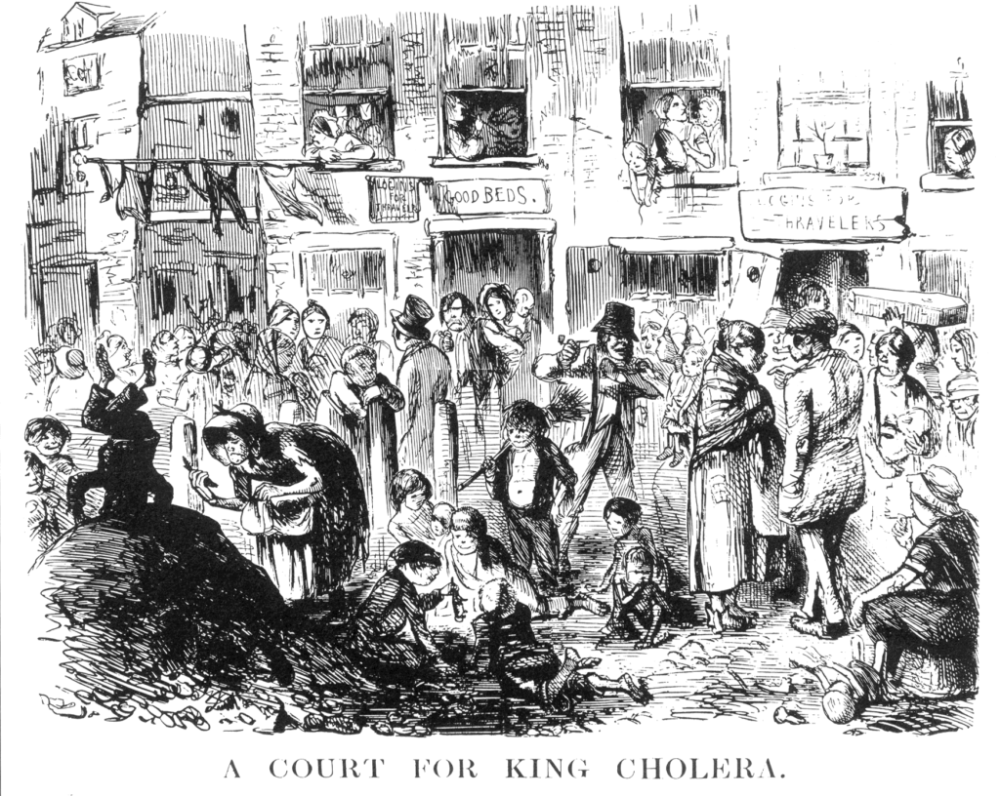{height="330"}
:::
::: {.column width="50%"}
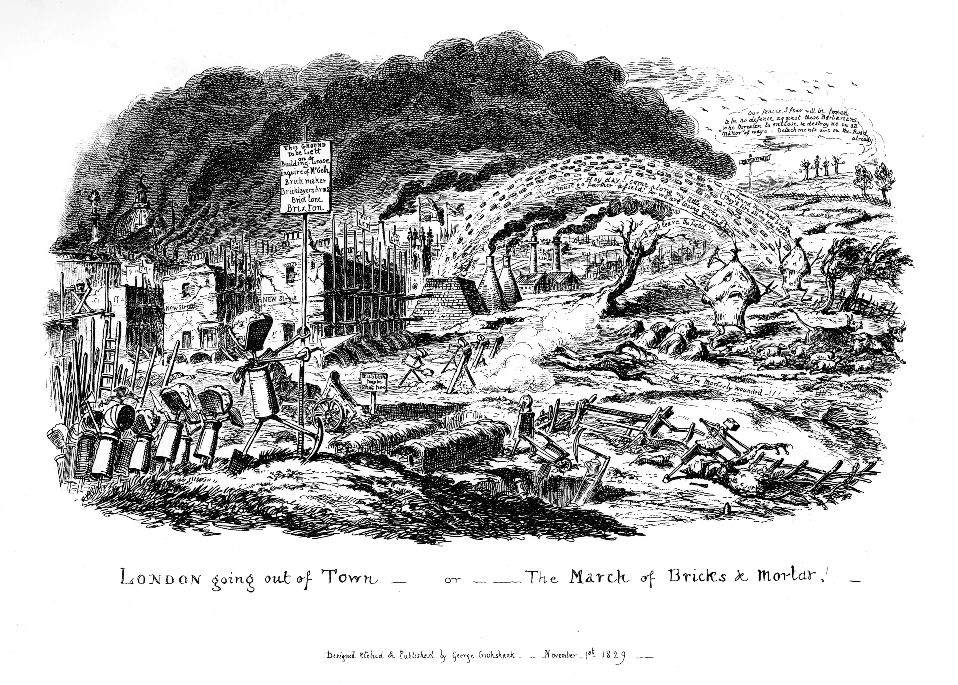{height="330"}
:::
::::

Crowding, no sewers, shared wells. Cholera, typhoid and tuberculosis followed.

::: aside
Images: from seminar deck (public domain works; scan sources to be confirmed).
:::

## Chadwick's table: average age at death, 1842 {.smaller}

| Place | Gentry | Labourers |
|---|---|---|
| Rutland (rural) | 52 | 38 |
| Liverpool | 35 | 15 |
| Manchester | 38 | 17 |

. . .

::: {.callout-tip appearance="simple"}
Which is worse: a Liverpool gentleman or a Rutland labourer? The Rutland labourer (38) outlived the Liverpool gentleman (35). **Where you lived mattered as much as who you were.**
:::

::: {.callout-warning appearance="simple"}
This is *average age at death*, not life expectancy. It depends on how many young people live in the town. Farr pointed this out almost at once.
:::

::: aside
Source: Hanley 2002, Med Hist. Manchester labourers appear as 17 in one table and 15 in another.
:::

## Edwin Chadwick and the 1842 report {.smaller}

:::: {.columns}
::: {.column width="35%"}
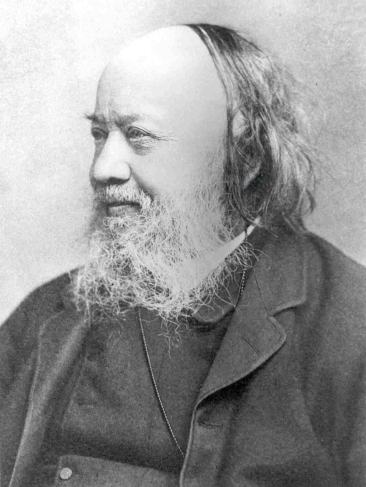{height="340"}
:::
::: {.column width="35%"}
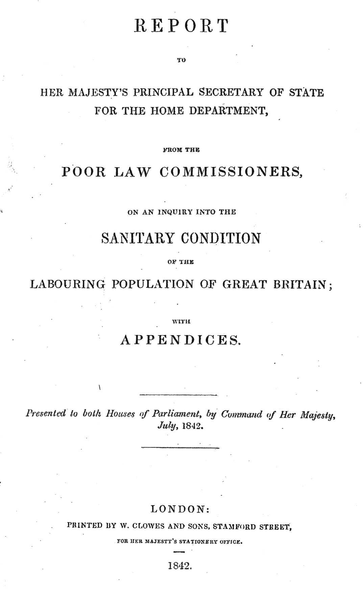{height="340"}
:::
::: {.column width="30%"}
- Poor Law official. Inquiry began 1839
- *Report on the Sanitary Condition of the Labouring Population of Great Britain*, **July 1842**
- Published at his own expense. A best-seller
:::
::::

::: aside
Sources: Hanley 2002; Wellcome Collection L0008334 (CC BY 4.0); portrait: seminar deck.
:::

## The sanitary idea {.smaller}

:::: {.columns}
::: {.column width="50%"}
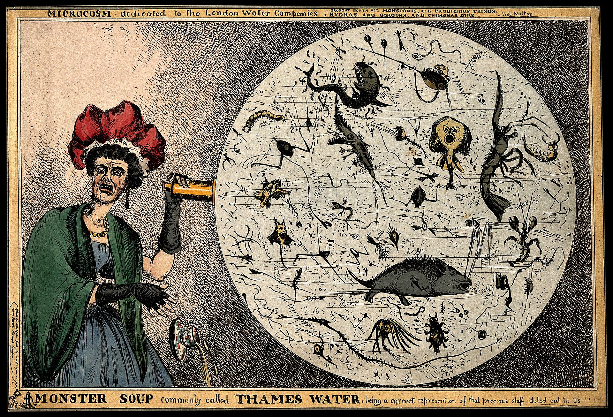{height="320"}
:::
::: {.column width="50%"}
- Constant water supply to every house
- Water-closets draining into sewers; waste carried away
- Disease blamed on foul air (**miasma**)
- Wrong theory, but **right action**: clean water and drains worked
:::
::::

::: aside
Image: William Heath, Wellcome V0011218 (public domain). Source: Wikipedia, Edwin Chadwick (secondary).
:::

## The Public Health Act 1848 {.smaller}

- Royal assent **31 August 1848**. Created a General Board of Health
- **Permissive:** a town could set up a local board if one-tenth of ratepayers petitioned, or be forced if its death rate was high
- The Board was abolished in 1858. Chadwick himself was pushed out in 1854

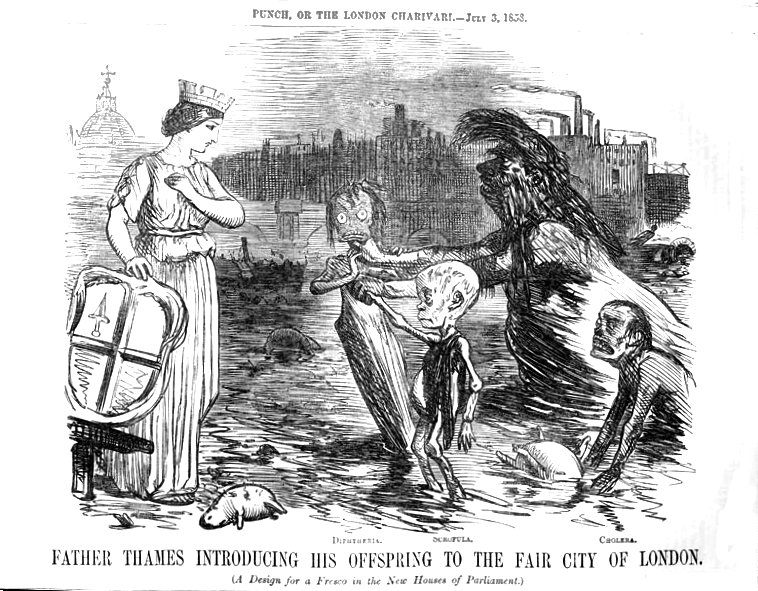{fig-align="center" height="230"}

::: aside
Sources: Wikipedia, Public Health Act 1848 (secondary). Image: Punch 1858, "Father Thames" (public domain).
:::

## Public health always meets politics

::: {.callout-note appearance="simple"}
The sanitary reformers faced engineers, water companies and people who opposed central control. Many of these arguments are still alive today.
:::

Question for the class: **who pays, and who decides?**

## William Farr {.smaller}

:::: {.columns}
::: {.column width="35%"}
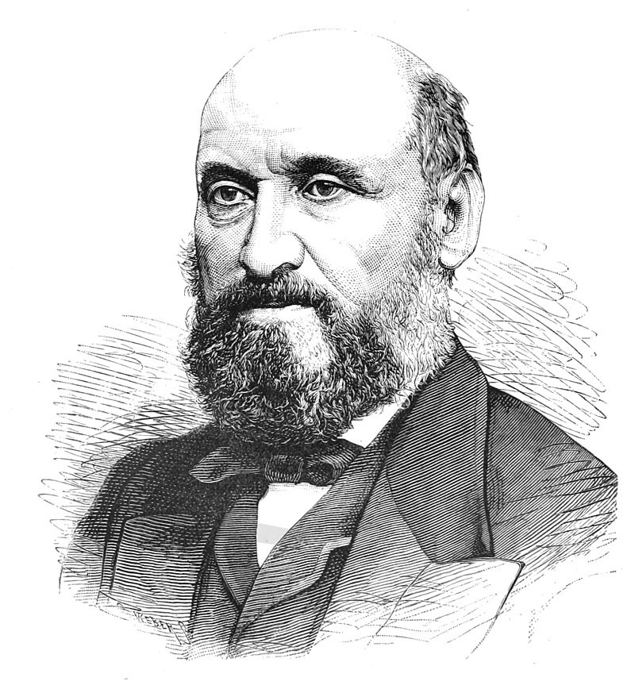{height="340"}
:::
::: {.column width="65%"}
- Compiler of Abstracts at the General Register Office, from 1839 or 1840
- Built the national system of death registration and a disease classification
- Ran the numbers on cholera in 1848 to 1849 (published 1852)
:::
::::

::: aside
Sources: Eyler 2001; New Palgrave. Portrait: seminar deck.
:::

## Farr's elevation law {.smaller}

- In 38 London districts, cholera deaths **fell as height above the Thames rose**
- This fitted the miasma idea: foul air collects in low ground
- Later reanalysis: water supply was also strongly linked, perhaps more than elevation

::: {.callout-warning appearance="simple"}
The data were right. The **explanation** was wrong. Low ground was also where the dirtiest water was served.
:::

::: aside
Sources: Registrar-General 1852; Bingham et al. 2004, Public Health; Eyler 2001.
:::

## A statistician changes his mind {.smaller}

- In the 1850s Farr was the recognised authority. Snow was the outsider
- After the **1866 East London outbreak**, which Farr traced to the Old Ford reservoir, he accepted that water carried cholera
- Counting exposed the pattern. Then new data changed the explanation

::: {.callout-tip appearance="simple"}
Good science updates when data demand it.
:::

::: aside
Source: Eyler 2001, Soz Praventivmed (abstract); Wikipedia, William Farr (secondary).
:::

## John Snow {.smaller}

:::: {.columns}
::: {.column width="35%"}
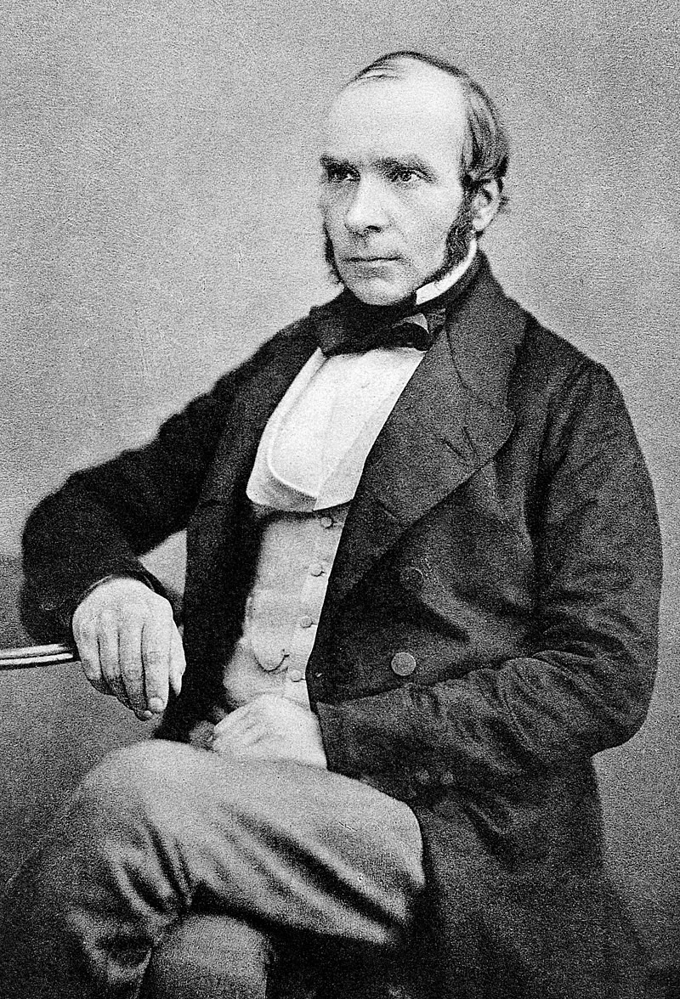{height="340"}
:::
::: {.column width="65%"}
- London physician and anaesthetist
- In **1849** he argued that cholera spreads by water, not air
- He had formed the hypothesis **before** the 1854 outbreak
:::
::::

::: aside
Source: Snow 1855. Portrait: seminar deck.
:::

## Broad Street, 31 August 1854 {.smaller}

:::: {.columns}
::: {.column width="55%"}
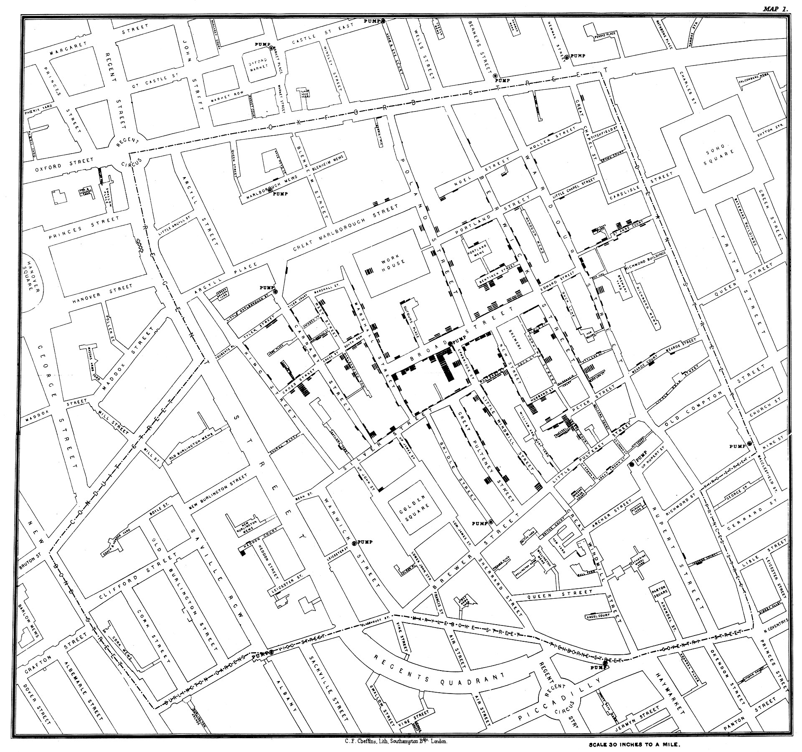{height="400"}
:::
::: {.column width="45%"}
- Outbreak began in the night of 31 August to 1 September
- More than **500 fatal attacks in ten days**
- Snow marked deaths on a map and found them clustered around the Broad Street pump
:::
::::

::: aside
Image: John Snow, 1855 (public domain). Source: Snow 1855; Frerichs, UCLA Snow site.
:::

## Two odd-one-out groups {.smaller}

:::: {.columns}
::: {.column width="45%"}
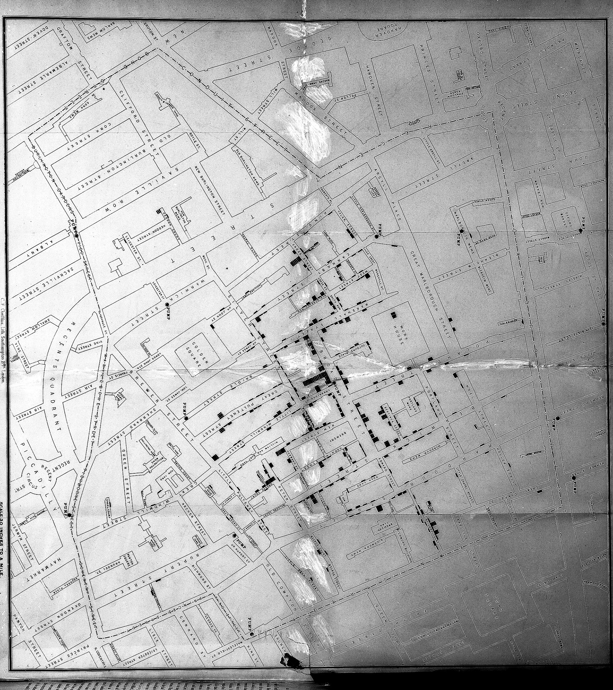{height="360"}
:::
::: {.column width="55%"}
- **Poland Street workhouse:** surrounded by deaths, but only 5 of 535 inmates died. It had its own well
- **Broad Street brewery:** about 70 workmen, none seriously ill. They drank malt liquor, "not water at all", and had a deep well on site
:::
::::

::: aside
Sources: Snow 1855. Image: Wellcome Collection L0003055 (CC BY 4.0).
:::

## The widow in Hampstead {.smaller}

- A 59-year-old widow lived in Hampstead and had not been near Broad Street for months
- She liked the taste of the Broad Street water. A cart brought her a large bottle on 31 August
- She died on 2 September. A niece who drank some also died
- No cholera in either neighbourhood

::: {.callout-note appearance="simple"}
Snow called this "perhaps the most conclusive of all". One case, one exposure, one place.
:::

::: aside
Source: Snow 1855 (primary).
:::

## The "grand experiment" {.smaller}

> "No fewer than three hundred thousand people of both sexes, of every age and occupation... were divided into two groups without their choice, and, in most cases, without their knowledge; one group being supplied with water containing the sewage of London... the other group having water quite free from such impurity."

| Water company, first seven weeks of 1854 | Deaths per 10,000 houses |
|---|---|
| Southwark & Vauxhall (sewage-contaminated) | **315** |
| Lambeth (intake moved upriver, 1852) | **37** |
| Rest of London | 59 |

::: aside
Source: Snow 1855, Table IX. Over the first four weeks the ratio was 71 vs 5 (14 times); say which period you quote.
:::

## Did removing the pump handle end the outbreak?

| Date (1854) | New attacks |
|---|---|
| 1 September | **143** |
| 8 September (handle removed) | 12 |
| 9 September | 11 |
| 10 and 11 September | 5 each |
| 12 September | 1 |

. . .

::: {.callout-important appearance="simple"}
Attacks were already falling before the handle came off, and many residents had fled. Snow himself wrote that it was "impossible to decide" whether the well was still dangerous. The handle was a sensible precaution and a symbol, not proof.
:::

::: aside
Source: Snow 1855 (primary); Brody et al. 2000, Lancet.
:::

## The curate and the baby {.smaller}

- The Rev. Henry Whitehead, a local curate, began as a sceptic and became Snow's ally
- His house-to-house enquiry traced the likely first case to **Frances Lewis**, an infant at 40 Broad Street, ill from about 28 August, died 2 September
- Her soiled napkins were washed and the water drained near the well. Brickwork later found decayed
- Linked by spring 1855 (sources differ on the exact date)

::: {.callout-note appearance="simple"}
Local knowledge plus a systematic enquiry found what the map alone could not.
:::

::: aside
Sources: UCLA Snow site (Frerichs); Cumbrian Lives; Cholera and the Thames (secondary).
:::

## What the map did and did not do {.smaller}

- Snow's hypothesis came **first**. The map came later and supported it. Others' maps had been used to argue for miasma
- A map shows. **Comparison proves.**
- The official General Board of Health inquiry still rejected his water theory in 1854
- "Father of epidemiology" is a contested label. Safer: **"a founder of modern epidemiological method"**

::: aside
Sources: Brody et al. 2000; Paneth et al. 1998; Koch 2014 (Int J Epidemiol).
:::

## Lemuel Shattuck: a blueprint, 1850 {.smaller}

:::: {.columns}
::: {.column width="30%"}
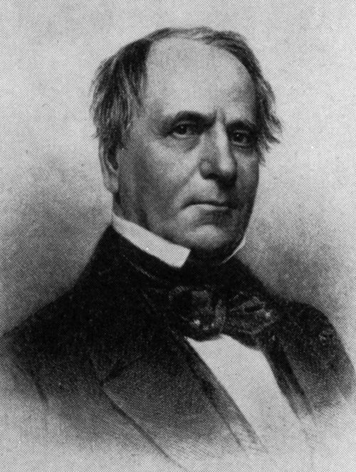{height="320"}
:::
::: {.column width="30%"}
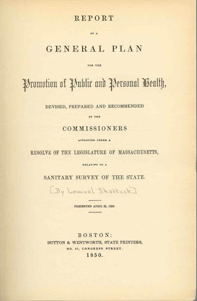{height="320"}
:::
::: {.column width="40%"}
- *Report of the Sanitary Commission of Massachusetts*, 1850
- About 50 recommendations: state and local health boards, vital statistics, school health, nurse training
- Massachusetts created a State Board of Health only in **1869**
:::
::::

::: aside
Sources: Wellcome catalogue; Public Health Museum catalogue (the "about 50" count is from secondary summaries).
:::

## The germ theory handoff {.smaller}

:::: {.columns}
::: {.column width="30%"}
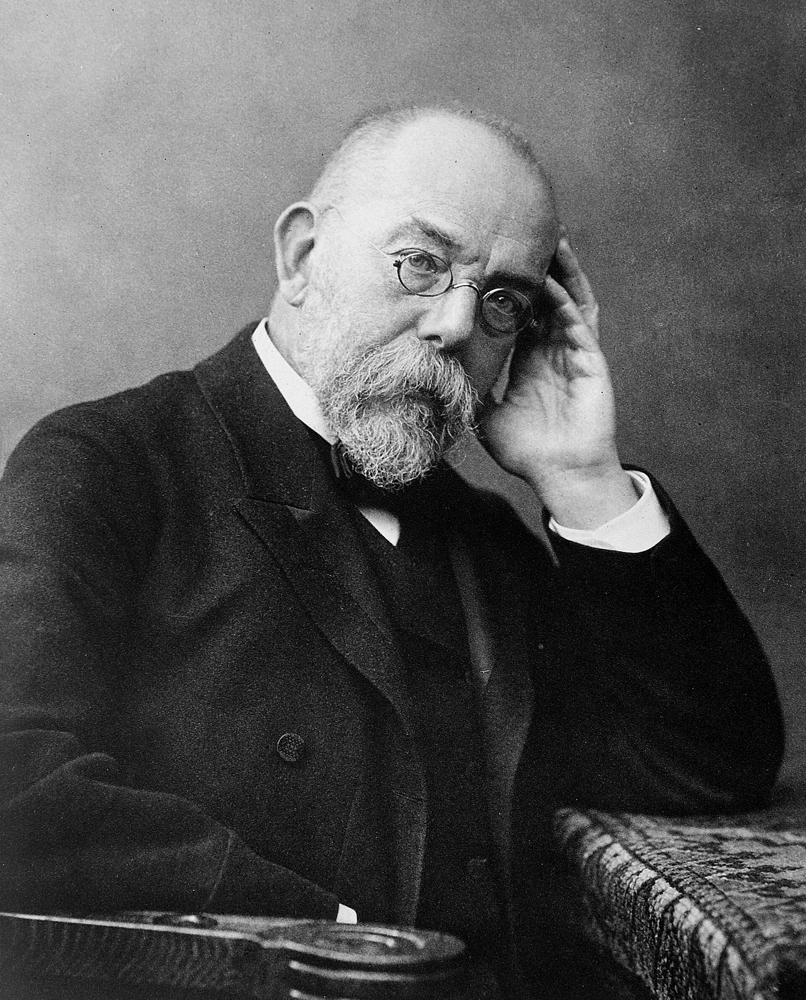{height="260"}
:::
::: {.column width="30%"}
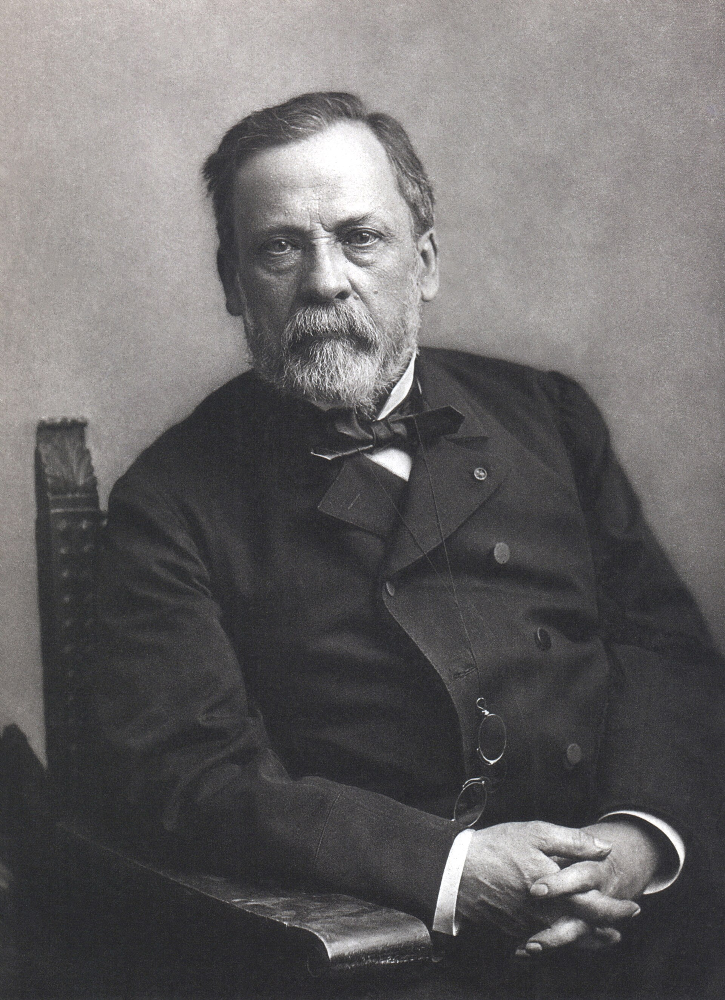{height="260"}
:::
::: {.column width="40%"}
- **1854:** Pacini described the comma-shaped cholera bacillus in Florence
- **1883 to 1884:** Koch isolated it in pure culture (Egypt, then Calcutta)
- Chadwick and Snow acted **before** the cause was proven. The microbes explained why it worked
:::
::::

::: aside
Sources: Lippi and Gotuzzo 2014; Wikipedia, Filippo Pacini (secondary). Images: Fechner; Nadar (public domain).
:::

## Semmelweis: handwashing, 1847 {.smaller}

- Vienna General Hospital. Women delivered by **doctors and students** died of childbed fever far more often than women delivered by **midwives** (roughly 10% against 4%)
- The doctors also did autopsies. Semmelweis ordered handwashing in chlorinated lime in **May 1847**. Deaths fell sharply
- He published in 1861. Colleagues rejected the idea. He died in an asylum in 1865
- The lesson: a **right result with no mechanism** is easy to dismiss. Germ theory came later

::: aside
Sources: Semmelweis 1861; Best and Neuhauser 2004, Qual Saf Health Care. Exact mortality figures need checking against the primary tables.
:::

## Lister: antisepsis {.smaller}

- **Joseph Lister**, surgeon in Glasgow. Wounds often turned septic and many surgical patients died
- He read Pasteur's work on microbes and used **carbolic acid** on wounds, dressings and instruments (first case 1865; published in the Lancet 1867)
- Wound infection fell. Pasteur gave the mechanism; Lister gave the practice
- Public health link: **infection control** in hospitals starts here

::: aside
Sources: Lister 1867, Lancet; Pitt and Aubin 2012, J Med Biogr.
:::

## Florence Nightingale: data that persuaded {.smaller}

- **Crimean War, 1854 to 1856.** At the Scutari hospital the death rate was about **42%** in February 1855. It fell to about **2%** by June, after a Sanitary Commission fixed drains and ventilation
- She was a statistician as well as a nurse. Her **polar-area diagram** (1858) showed that most deaths were from disease, not wounds
- First woman Fellow of the Royal Statistical Society (1858). *Notes on Nursing* (1859). She later pressed for sanitary reform of the army in India
- The lesson: **a good picture moves officials** who will not read tables

::: aside
Sources: Nightingale 1858, *Notes on matters affecting the health ... of the British army*; Gill and Gill 2005, J R Soc Med. Figures are her own and are debated.
:::

## Ross and malaria: Secunderabad, 1897 {.smaller}

- **Ronald Ross**, Indian Medical Service. On **20 August 1897**, in Secunderabad (now Hyderabad), he found malaria parasites in the stomach of a mosquito
- Nobel Prize in Physiology or Medicine, **1902**
- In 1911 he wrote the first **mathematical model** of malaria. In 1927 Kermack and McKendrick published the SIR model that epidemic models still use
- Public health link: **vector control** (drain, oil, net). Cause found, then control by design

::: aside
Sources: Nobel Prize site, Ross biography; Smith, Ross and the 1911 model, Malar J 2012 [verify citation]. The institute is at Begumpet, Hyderabad.
:::

## Smallpox: acting before the mechanism {.smaller}

:::: {.columns}
::: {.column width="50%"}
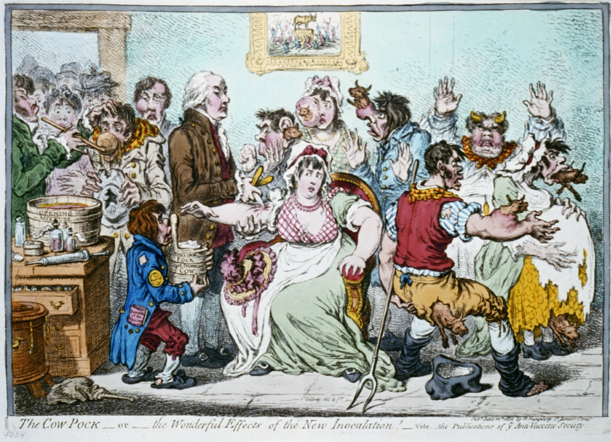{height="320"}
:::
::: {.column width="50%"}
- **1796:** Jenner inoculated 8-year-old James Phipps with cowpox, then challenged him with smallpox. He stayed well
- WHO Intensified Programme began **1967**
- India's last case: May **1975**, Assam. India certified free in April **1977**. WHO declared eradication in **1980**
:::
::::

::: aside
Sources: WHO; University of Michigan exhibit; NCERT 2013. Image: Gillray, Library of Congress (public domain).
:::

## Two documents that shaped primary care {.smaller}

:::: {.columns}
::: {.column width="45%"}
{width="100%"}
:::
::: {.column width="55%"}
- **Bhore Committee** (set up 1943, reported **1946**): integrate preventive and curative care; build primary health centres
- **Alma-Ata Declaration** (12 September **1978**): "Health for All" by 2000 through primary health care. 134 countries
- Rural medical schemes existed before Bhore, so "Bhore invented rural health" is too simple
:::
::::

::: aside
Sources: Handa 2024, Cureus; PAHO and WHO Alma-Ata pages; Pandya 2017. Image: Wikimedia Commons (CC BY-SA 3.0; author to be confirmed).
:::

## Recap {.smaller}

{fig-align="center" width="100%"}

- **Cities and cholera** made disease a social problem
- **Chadwick** built the sanitary idea. **Farr** counted. **Snow** compared. **Shattuck** wrote the blueprint
- **Germ theory** explained afterwards why the actions worked
- **Semmelweis, Lister, Nightingale and Ross:** hands, wounds, wards and mosquitoes. Practice and data moved ahead of theory, then theory caught up
- Smallpox, Bhore and Alma-Ata: public health as a state goal

## Quiz: question 1 of 8

Chadwick's 1842 report mainly argued for:

a) vaccination

b) sanitary reform (water, drains, waste)

c) hospital building

d) quarantine

## Quiz: question 2 of 8

William Farr is best known for:

a) the pump handle

b) systematic collection and analysis of vital statistics

c) germ theory

d) the microscope

## Quiz: question 3 of 8

Snow's key evidence in 1854 was:

a) the smell of the air

b) cases clustered around one pump, plus a comparison of water supplies

c) laboratory culture of the cholera bacillus

d) autopsy findings

## Quiz: question 4 of 8

Chadwick and Snow both acted before the cause was proven. This shows that:

a) theory is useless

b) effective action can come from observing patterns

c) miasma was correct

d) sanitation did not help

## Quiz: question 5 of 8

Shattuck's 1850 report recommended:

a) a war on tuberculosis

b) local health boards and vital statistics

c) compulsory vaccination

d) a national hospital service

## Quiz: question 6 of 8

Which later work identified the cause of cholera in pure culture?

a) Hippocrates' humours

b) Galen's anatomy

c) Koch's isolation of the cholera bacillus (1883 to 1884)

d) Graunt's tables

## Quiz: question 7 of 8

Semmelweis cut childbed fever deaths in Vienna in 1847 by:

a) quarantine of the ward

b) handwashing in chlorinated lime

c) a new vaccine

d) opening the windows

## Quiz: question 8 of 8

Florence Nightingale is also remembered in public health for:

a) discovering the cholera bacillus

b) the polar-area diagram showing deaths by cause

c) the first smallpox vaccine

d) the Public Health Act 1848

## Quiz answers

1. **b** sanitary reform
2. **b** vital statistics
3. **b** clustering around one pump, plus comparison of water supplies
4. **b** effective action can come from observing patterns
5. **b** local health boards and vital statistics
6. **c** Koch's isolation of the cholera bacillus (Pacini had seen the organism in 1854)
7. **b** handwashing in chlorinated lime
8. **b** the polar-area diagram showing deaths by cause

## Take-home

- Public health began when people **counted, mapped, compared and acted** on whole populations
- The method (count, compare, intervene) outlived the wrong theory (miasma)
- Read the myths carefully: the pump handle did not clearly end the outbreak
- Next (Lecture 4): the twentieth century and now: antibiotics, WHO, primary care, determinants, ethics, India, COVID-19

## References (1 of 2) {.smaller}

- Hanley J. Edwin Chadwick and the poverty of statistics. Med Hist. 2002;46(1):21-40
- Snow J. On the mode of communication of cholera. 2nd ed. London: Churchill; 1855. gutenberg.org/ebooks/72894
- Brody H, et al. Map-making and myth-making in Broad Street. Lancet. 2000;356(9223):64-8
- Paneth N, et al. A rivalry of foulness. Am J Public Health. 1998;88(10):1545-53
- Eyler JM. The changing assessments of John Snow's and William Farr's cholera studies. Soz Praventivmed. 2001;46(4):225-32

## References (2 of 2) {.smaller}

- Lippi D, Gotuzzo E. The greatest steps towards the discovery of Vibrio cholerae. Clin Microbiol Infect. 2014;20(3):191-5
- Handa A, et al. Joseph William Bhore. Cureus. 2024;16(8):e67405
- WHO. History of smallpox vaccination; Declaration of Alma-Ata (1978)
- Best M, Neuhauser D. Ignaz Semmelweis and the birth of infection control. Qual Saf Health Care. 2004;13(3):233-4
- Gill CJ, Gill GC. Nightingale in Scutari: her legacy reexamined. Clin Infect Dis. 2005;40(12):1799-805
- Koch T. Nobody loves a critic: Edmund A Parkes and John Snow's cholera. Int J Epidemiol. 2013;42(6):1553-9
