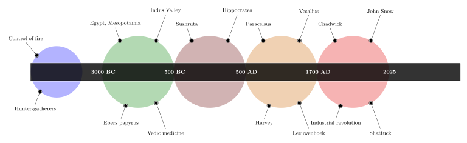
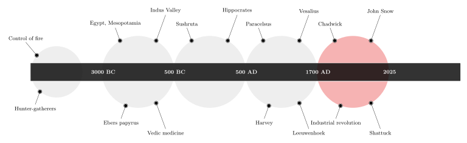
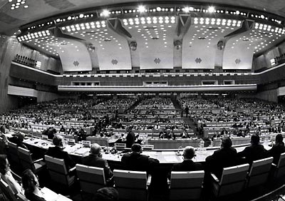

## Where we left off {.smaller}

::: {.columns}
::: {.column width="55%"}
**Lecture 3** showed how counting, mapping and sanitation made populations the unit of care, and how germ theory explained why it worked.

**Today:** what the twentieth century added. Better drugs, global institutions, and a harder question: **why are some people healthier than others?**

**Thread:** from killing germs, to organising care, to changing the conditions of life, and to doing it ethically.
:::
::: {.column width="45%"}
{width="100%"}
:::
:::

## Learning objectives

By the end of this lecture you should be able to:

1. Explain how antibiotics, epidemiology and the Flexner model shaped medicine and public health
2. Place WHO, Alma-Ata and the Ottawa Charter on the timeline and say what each added
3. Explain the epidemiologic transition and the social determinants of health
4. Describe why research ethics codes were written
5. Name major Indian milestones, and three current threats: COVID-19, antimicrobial resistance and zoonoses

## Today on the timeline

{fig-align="center" width="100%"}

- **1900 to 1950:** drugs, schools, systems
- **1950 to 1990:** primary care, risk factors, determinants
- **1990 to now:** global health, pandemics and resistance

## Question

Which has saved more lives since 1900: **medicines**, or **clean water, food, vaccines and better living conditions**?

. . .

::: {.callout-tip appearance="simple"}
Much of the fall in infectious death rates came **before** effective drugs (McKeown's argument, still debated). Keep this in mind through the lecture.
:::

## Flexner, 1910: medicine becomes science-based {.smaller}

- The Carnegie Foundation asked **Abraham Flexner** to review medical schools in the United States and Canada (Bulletin No. 4, 1910)
- Result: laboratory science, hospital teaching, university links. Many weak schools closed
- Gains: better training and safer practice
- Costs, said critics: attention narrowed to the **individual patient and disease**. Social and population thinking weakened. Many Black and women's colleges closed

::: {.callout-note appearance="simple"}
Why it matters to Community Medicine: the field exists partly to put back what the biomedical model left out.
:::

::: aside
Sources: Flexner 1910; Hiatt and Stockton 2003, Acad Med.
:::

## Antibiotics: penicillin and after {.smaller}

- **1928:** Alexander Fleming noticed a mould killing bacteria on a plate
- **1930s and 1940s:** Florey, Chain and colleagues made it a usable drug. Nobel Prize 1945. First treated patient: Oxford, 1941
- Sulfonamides came first (1935), then streptomycin (1943) and the first effective TB treatment
- Within decades, **resistance** followed. We return to this at the end

::: {.callout-note appearance="simple"}
Public health link: a drug is a tool. Treating one patient is not the same as controlling a disease in a population.
:::

::: aside
Sources: Fleming 1929, Br J Exp Pathol; Gaynes 2017, Emerg Infect Dis.
:::

## Epidemiology grows up {.smaller}

- **1948:** Framingham Heart Study begins. Risk factors for heart disease are named
- **1950:** Doll and Hill, a **case-control** study of smoking and lung cancer. **1954:** the British doctors **cohort** study follows
- **1965:** Bradford Hill's viewpoints for judging cause (strength, consistency, temporality and others)
- Method change: from **outbreaks of infection** to **chronic disease in populations**

::: {.callout-note appearance="simple"}
This is the toolkit you meet in the epidemiology module: case-control, cohort, and causal reasoning.
:::

::: aside
Sources: Doll and Hill 1950, BMJ; Doll and Hill 1954, BMJ; Hill 1965, Proc R Soc Med. Framingham start date and first report: check Dawber 1951.
:::

## 1948: WHO and the NHS {.smaller}

:::: {.columns}
::: {.column width="55%"}
- **WHO** constitution in force **7 April 1948**
- Definition of health: "a state of complete physical, mental and social well-being and not merely the absence of disease or infirmity"
- **NHS** (UK) began **5 July 1948**: care free at the point of use, paid by tax. Based on the Beveridge Report (1942)
:::
::: {.column width="45%"}
::: {.callout-note appearance="simple"}
Two models: a **global agency** that sets norms and coordinates, and a **national system** that funds care for everyone. Both still shape debate in India.
:::
:::
::::

::: aside
Sources: WHO Constitution; UK Government NHS history.
:::

## The epidemiologic transition {.smaller}

- **Abdel Omran, 1971:** populations move through stages
  1. **Pestilence and famine:** infections, high deaths, short lives
  2. **Receding pandemics:** sanitation, nutrition, vaccines
  3. **Degenerative and man-made diseases:** heart disease, cancer, injury
- India now carries **both** burdens at once. Some call this a double burden, or a protracted transition

::: {.callout-note appearance="simple"}
Public health link: planning must match the disease pattern. A district may need TB services and hypertension services together.
:::

::: aside
Sources: Omran 1971, Milbank Mem Fund Q.
:::

## Lalonde, 1974: four parts of health {.smaller}

- Canada's Minister of Health, **Marc Lalonde**, published *A New Perspective on the Health of Canadians*
- The **health field concept:** four influences on health
  - **Human biology**
  - **Environment**
  - **Lifestyle**
  - **Health care organisation**
- It showed that most health spending went to the fourth, while much of the burden came from the other three

::: aside
Sources: Lalonde 1974.
:::

## Alma-Ata, 1978: Health for All {.smaller}

:::: {.columns}
::: {.column width="45%"}
{width="100%"}
:::
::: {.column width="55%"}
- **6 to 12 September 1978**, USSR. WHO and UNICEF conference
- **Primary health care:** essential, community-based, affordable, with community participation and action across sectors
- Goal: **Health for All by 2000**
- **1979:** Walsh and Warren proposed *selective* primary health care (a few cheap interventions, such as GOBI). Many saw this as a step back
- **2018:** Astana Declaration renewed the commitment
:::
::::

::: aside
Sources: WHO 1978; Walsh and Warren 1979, N Engl J Med; WHO 2018. Image: Wikimedia Commons (as in L3).
:::

## Ottawa Charter, 1986: health promotion {.smaller}

The first international conference on health promotion, Ottawa, November 1986. Five action areas:

1. **Build healthy public policy**
2. **Create supportive environments**
3. **Strengthen community action**
4. **Develop personal skills**
5. **Reorient health services**

::: {.callout-note appearance="simple"}
Health is made where people live, work and play, not only in clinics. Compare Chadwick: policy first.
:::

::: aside
Sources: WHO 1986, Ottawa Charter for Health Promotion.
:::

## Social determinants of health {.smaller}

- **Rudolf Virchow, 1848:** a typhus report from Upper Silesia blamed poverty and politics. He is credited with the line that medicine is a social science
- **Black Report, UK, 1980:** death rates followed social class
- **Whitehall studies** (Michael Marmot): in the same civil service, lower grades had higher heart disease and death rates
- **WHO Commission, 2008:** *Closing the gap in a generation*. Health gaps are shaped by **power, money and resources**, so they are not natural

::: aside
Sources: Virchow 1848; Black 1980; Marmot 1978, J Epidemiol Community Health; WHO CSDH 2008. Virchow's wording is a later paraphrase.
:::

## Question

Two women in the same district have the same illness. One recovers, one dies. List **three reasons** that have nothing to do with the drug.

. . .

::: {.callout-tip appearance="simple"}
Income, distance to a facility, education, caste, gender, health insurance, nutrition, work conditions. These are the **determinants**.
:::

## Why research ethics exists {.smaller}

- **Nuremberg Code, 1947:** from the Doctors' Trial, after abuses in Nazi camps. First principle: **voluntary consent is essential**
- **Tuskegee, 1932 to 1972:** US Public Health Service followed Black men with syphilis and withheld proven treatment. Press exposure stopped it
- **Declaration of Helsinki, 1964:** World Medical Association; revised many times
- **Belmont Report, 1979:** respect for persons, beneficence, justice
- **India:** ICMR ethical guidelines, first issued 1980 and revised since (latest 2017)

::: {.callout-note appearance="simple"}
Link back to Sushruta and Hippocrates: the duty of the doctor to the patient, now written as rules for **research**.
:::

::: aside
Sources: Nuremberg Code 1947; Jones 1981, *Bad Blood*; WMA Helsinki; Belmont Report 1979; ICMR 2017.
:::

## India: plague, law and institutions {.smaller}

- **1896:** plague reached Bombay. **1897:** Waldemar Haffkine made a plague vaccine. **Epidemic Diseases Act, 1897:** wide powers to the state
- The same Act was used again in **2020** for COVID-19
- **1946:** Bhore Committee (see L3). **1952:** Community Development Programme and the first primary health centres
- **2005:** National Rural Health Mission, later the National Health Mission
- **2018:** Ayushman Bharat: Health and Wellness Centres plus a public insurance scheme (PM-JAY)

::: aside
Sources: Arnold 1993, *Colonizing the Body*; Government of India, MoHFW. Check dates before citing.
:::

## India: polio and the long campaign {.smaller}

- **1978:** Expanded Programme on Immunisation begins. **1985:** Universal Immunisation Programme
- **Pulse Polio** from **1995**
- Last wild poliovirus case in India: **13 January 2011**
- WHO certified the **South-East Asia Region** polio-free on **27 March 2014**

::: {.callout-note appearance="simple"}
Public health link: it took mass campaigns, surveillance of acute flaccid paralysis, and workers going house to house. Smallpox and polio show the same pattern: **simple tools, delivered at scale, with good data**.
:::

::: aside
Sources: WHO SEARO 2014; MoHFW immunisation pages.
:::

## COVID-19 {.smaller}

- **30 January 2020:** WHO declared a public health emergency of international concern. **11 March 2020:** declared a pandemic
- WHO estimated about **14.9 million excess deaths** in 2020 and 2021. This is far above the reported count
- Vaccines were authorised in about a year. This was a first for mRNA vaccines
- Old tools came back: **surveillance, testing, isolation, quarantine, masks, and the 1897 Act**
- New questions: data, equity, trust, and misinformation

::: {.callout-note appearance="simple"}
Snow and Farr's methods ran the dashboards. Chadwick's problem, **unequal exposure**, returned in every city.
:::

::: aside
Sources: WHO 2022; Msemburi 2023, Nature. Check the latest WHO figures before teaching.
:::

## Antimicrobial resistance {.smaller}

- Antibiotics are used in people, animals and farms. Resistance spreads between all three
- The GRAM study (Lancet, 2022): about **1.27 million deaths** directly caused by bacterial resistance in 2019, and about **4.95 million** associated with it
- Causes: overuse, poor infection control, weak labs and water and sanitation gaps
- Response: stewardship, infection control, new drugs, and better data

::: {.callout-note appearance="simple"}
This closes a loop from Lister and Semmelweis: **infection control** is again a front line.
:::

::: aside
Sources: Murray 2022, Lancet; WHO global action plan on AMR.
:::

## One Health {.smaller}

- Most new infections of people come from **animals** (zoonoses): rabies, Nipah, avian influenza, COVID-19 (origin still debated)
- **One Health** links human, animal and environmental health
- 2022: the **Quadripartite** alliance of FAO, WOAH, UNEP and WHO
- Climate change, land use and trade change where and when diseases appear

::: {.callout-note appearance="simple"}
Ancient echo: *Airs, Waters, Places* (L1). The environment is part of the cause.
:::

::: aside
Sources: One Health High-Level Expert Panel 2022; WHO.
:::

## Data and AI: an optional last word {.smaller}

- Graunt's tables, Farr's registers and Nightingale's diagrams are now **electronic records, registries and models**
- Tools can find signals faster, such as outbreak alerts
- Old risks remain: **bad data, bias, privacy, and who is left out**
- Every new tool needs the same questions as Snow's map: *what does it show, and what does it not?*

## Recap {.smaller}

{fig-align="center" width="100%"}

- **Flexner, penicillin, epidemiology:** science-based care and drugs, then risk-factor thinking
- **WHO, Alma-Ata, Ottawa:** health as a right, built on primary care and promotion
- **Omran, Lalonde, determinants:** disease follows the conditions of life
- **Ethics:** consent and justice, written after harm
- **India, COVID-19, AMR, One Health:** old methods meet new threats

## Quiz: question 1 of 8

Which report in 1910 made US medical education science-based, and is criticised for narrowing focus to the individual?

a) Bhore

b) Flexner

c) Black

d) Lalonde

## Quiz: question 2 of 8

The WHO constitution defines health as:

a) absence of disease

b) a good diet

c) complete physical, mental and social well-being

d) long life

## Quiz: question 3 of 8

The Ottawa Charter (1986) is mainly about:

a) vaccination schedules

b) health promotion

c) surgical training

d) drug approval

## Quiz: question 4 of 8

The epidemiologic transition (Omran, 1971) describes a move:

a) from chronic disease to infection

b) from infection and famine toward degenerative and man-made diseases

c) from hospitals to homes

d) from rural to urban areas

## Quiz: question 5 of 8

The first principle of the Nuremberg Code is:

a) ethics committee review

b) payment of participants

c) voluntary consent

d) randomisation

## Quiz: question 6 of 8

Alma-Ata (1978) called for:

a) global vaccination only

b) primary health care as the route to Health for All

c) privatising hospitals

d) vertical programmes only

## Quiz: question 7 of 8

The Epidemic Diseases Act, 1897 was first used for plague and used again in:

a) 2005

b) 2009

c) 2014

d) 2020

## Quiz: question 8 of 8

Which best describes antimicrobial resistance?

a) a problem only for hospitals

b) a solved problem

c) a rising threat linked to antibiotic use in people, animals and the environment

d) a problem only in rich countries

## Quiz answers

1. **b** Flexner
2. **c** complete physical, mental and social well-being
3. **b** health promotion
4. **b** from infection and famine toward degenerative and man-made diseases
5. **c** voluntary consent
6. **b** primary health care as the route to Health for All
7. **d** 2020
8. **c** a rising threat linked to antibiotic use in people, animals and the environment

## Take-home

- Medicine got more powerful, yet **health still follows the conditions of life**
- Ask of any new tool: who gets it, who is left out, and what did they consent to?
- The same method runs through all four lectures: **count, compare, act, and check**

## References (1 of 2) {.smaller}

- Flexner A. Medical education in the United States and Canada. Carnegie Foundation Bulletin No. 4; 1910
- Doll R, Hill AB. Smoking and carcinoma of the lung. BMJ. 1950;2(4682):739-48
- Hill AB. The environment and disease: association or causation? Proc R Soc Med. 1965;58:295-300
- Omran AR. The epidemiologic transition. Milbank Mem Fund Q. 1971;49(4):509-38
- Lalonde M. A new perspective on the health of Canadians. Ottawa; 1974
- WHO. Declaration of Alma-Ata; 1978. Astana Declaration; 2018
- Walsh JA, Warren KS. Selective primary health care. N Engl J Med. 1979;301(18):967-74
- WHO. Ottawa Charter for Health Promotion; 1986

## References (2 of 2) {.smaller}

- WHO Commission on Social Determinants of Health. Closing the gap in a generation; 2008
- Marmot MG, et al. Employment grade and coronary heart disease in British civil servants. J Epidemiol Community Health. 1978;32:244-9
- Jones JH. Bad Blood: The Tuskegee Syphilis Experiment. Free Press; 1981
- National Commission. The Belmont Report; 1979
- ICMR. National ethical guidelines for biomedical and health research involving human participants; 2017
- Arnold D. Colonizing the Body. Univ California Press; 1993
- Msemburi W, et al. The WHO estimates of excess mortality associated with COVID-19. Nature. 2023;613:130-7
- Murray CJL, et al. Global burden of bacterial antimicrobial resistance in 2019. Lancet. 2022;399:629-55
